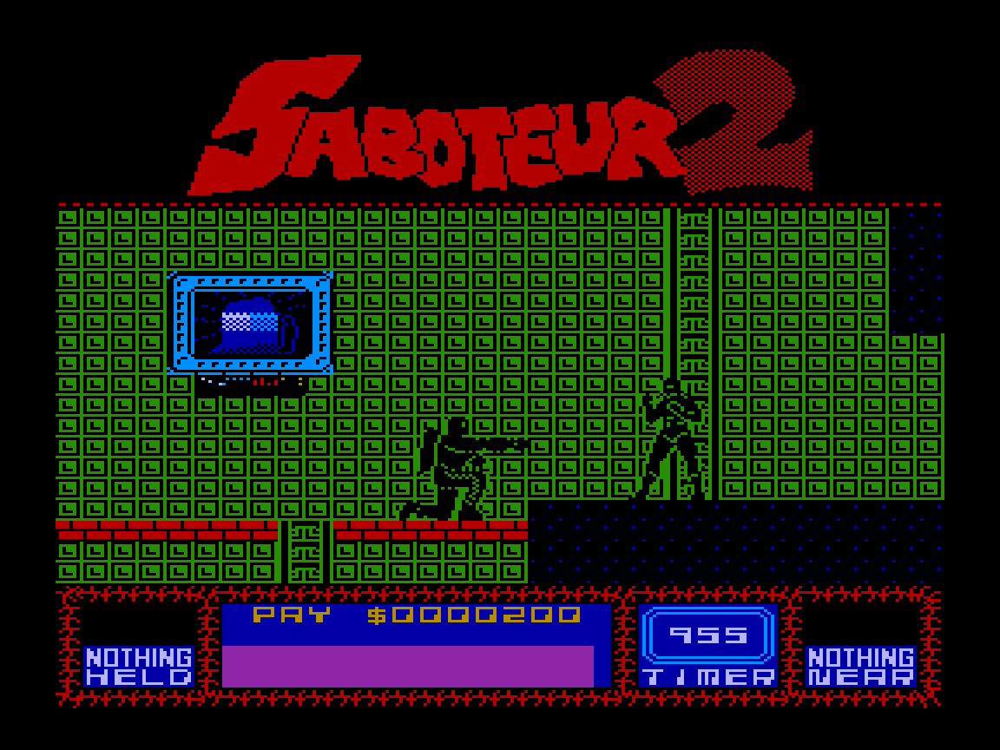

[Порт](https://thealfest.itch.io/saboteur-2-vector-06c) [модификации **Saboteur 2**](https://thealfest.itch.io/zx-spectrum-saboteur-2-mod) для ZX Spectrum на **Вектор-06Ц**.

Оригинальная игра — **Clive Townsend**.

## Требования

- Работает на стандартном **Векторе-06Ц** — никаких аппаратных расширений не требуется.
- Поддерживает несколько типов джойстиков. Тип джойстика определяется автоматически при нажатии кнопки «Огонь» во вступительном экране.

Протестировано в **Virtual Vector** и **Emu80**.

Помимо оригинальных **9 миссий**, в игре есть **7 достижений**, которые можно открыть, выполнив определённые задания.
Но игроку придётся самостоятельно выяснить, что именно для этого нужно сделать.

Возможно, вам пригодится [**карта игры**](saboteur_map.png).

