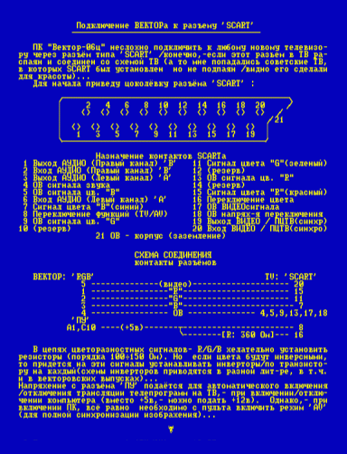

Принципиальные схемы «Вектора-06Ц» разных производителей, «ПК-6128Ц» и «Вектор Старт-1200».

- [Подключение Вектора к разъему SCART (Invector)](scart_invector)
- [Схемы ПЭВМ «Вектор Старт-1200»](start_1200)
- [Схемы ПЭВМ «Вектор-06Ц» (КК)](06c_kk)
- [Схемы ПЭВМ «Вектор-06ц.02» (Кишинев)](06c_02_kishinev)
- [Схемы ПЭВМ «Вектор-06ц» (Астрахань, КК)](06c_astrahan_kk)
- [Схемы ПЭВМ «Вектор-06ц» (Кишинев,ГК)](06c_kishinev_gk)
- [Схемы ПЭВМ «ПК-6128Ц»](pk_6128c)

