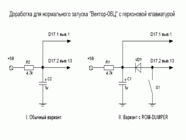
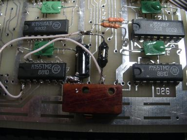

В ПЭВМ «Вектор-06Ц» с герконовой клавиатурой при первом включении наблюдается такой эффект: гудит встроенный динамик и светится светодиод `РУС`, при этом на экране отсутствует карта загрузки. Однократное нажатие `ВВОД`+`БЛК` переводит ПЭВМ в нормальный режим.

Причина эффекта заключается в том, что триггеры D17.1 и D17.2 (см. [Схемы ПЭВМ «Вектор-06ц» (Кишинев,ГК)](../06c_kishinev_gk)) при включении ПЭВМ устанавливаются в состояние, при котором ПЗУ не подключается, а ЦПУ не сбрасывается.

Предлагаемая доработка призвана устранить этот недостаток.

Диод VD1 и переключатель S1 устанавливаются для работы с программой [ROM-DUMPER (копировщик загрузчика)](../../romdump), которая считывает содержимое ПЗУ загрузчика без выпаивания микросхемы. Если использовать [ROM-DUMPER](../../romdump) не планируется, VD1 и S1 можно не ставить.

В моделях «Вектор-06Ц» с емкостной клавиатурой и «Вектор-06Ц.02» подобный эффект отсутствует.

На фото представлен вариант с ROM-DUMPER.

