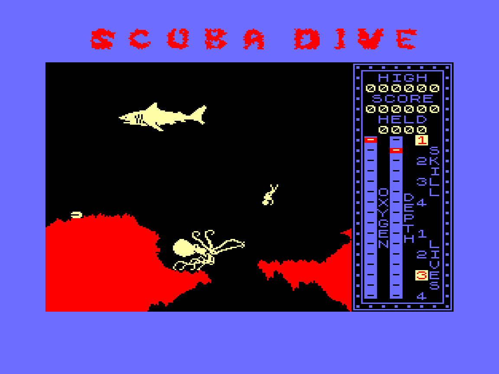

Порт игры **Scuba Dive** с ZX Spectrum (Durell Software, 1983) на [«Вектор-06Ц»](https://en.wikipedia.org/wiki/Vector-06C).

Игра предназначена **только для версии «Вектора-06Ц» с процессором Z80**.

Для машины с КР580ВМ80А доступна [версия Scuba Dive DX](../dx/README.md). Версия i8080 и DX также опубликованы в [репозитории проекта DX](https://github.com/reqw41/scubadive-dx-v06c).

| Файл                                     | Описание              |
| ---------------------------------------- | --------------------- |
| [scuba.rom](scuba.rom)                   | Игра                  |
| [scuba-cheats.rom](scuba-cheats.rom)     | Игра с читами         |
| [scuba-cheatoxy.rom](scuba-cheatoxy.rom) | Вариант cheatoxy      |
| [scubadive.7z](scubadive.7z)             | Архив исходных файлов |

## Исходные файлы

Игра собирается с помощью sjasmplus. `scubacod0.asm` — загрузчик; остальные файлы подключаются через `INCLUDE` к основному образу, собираемому из `scubacod1.asm`. Исходные файлы и скрипты находятся в архиве.

- **`scubacod0.asm`** — загрузчик (режим Intel 8080). При запуске с адреса `$0100` устанавливает обработчик прерываний и опрос клавиатуры и джойстика, настраивает палитру, распаковывает заставку и основной код игры (ZX0), затем передаёт управление игре. Экспортирует символы через `scubacod0.inc`.
- **`scubacod0.inc`** — автоматически создаваемый список экспортируемых символов и их адресов, получаемый при первом проходе сборки `scubacod0.asm` и подключаемый в `scubacod1.asm`. Вручную не редактируется.
- **`scubacod1.asm`** — основной файл игрового образа: переключатели читов, точка входа (заставка и меню), обработка клавиатуры и джойстика, заглушки вместо вызовов ПЗУ ZX Spectrum и строки меню и заставки. Подключает перечисленные ниже модули и размещает в памяти шрифт, мини-карту, панель, переменные и код.
- **`scubacoda.asm`** — блок игровых переменных и состояния по фиксированному адресу: начальное значение генератора случайных чисел, счёт, рекорд, уровень, количество объектов, указатели на области записей и другие данные.
- **`scubacodb.asm`** — первая часть игрового движка: отрисовка игрового экрана (`DrawGameScr`), поверхности моря и рельефа, обращение к мини-карте, преобразование адресов символов в адреса экрана, движение и появление существ, шаблоны записей объектов и рабочий буфер записей. Подключает `scubasprt.asm` и `scubarelf.asm`.
- **`scubacodc.asm`** — вторая часть игрового движка: основной цикл, водолаз (движение, столкновения, кислород, глубина, жизни), панель и индикаторы, подготовка уровней, мелодии, обработка рекорда в конце игры, меню и демонстрация.
- **`scubasprt.asm`** — графика спрайтов всех движущихся объектов (рыб, акул, осьминога, водолаза, лодки и других), а в конце файла — тайлы рельефа размером 8×8.
- **`scubarelf.asm`** — строительные блоки рельефа (каждый размером 8×8 тайлов), из которых составлен подводный ландшафт.
- **`scubammap.asm`** — мини-карта мира: сетка 32×32 номеров блоков рельефа, описывающая весь мир размером 256×256 тайлов.
- **`scubapanl.asm`** — графика панели состояния (индикаторы кислорода и глубины, уровень сложности, жизни и счёт), сжатая ZX0 и распаковываемая на экран при запуске игры.
- **`scubasymb.asm`** — набор символов и шрифт для экранного текста (знаки из ПЗУ ZX Spectrum).

Скрипты сборки и запуска:

- **`!compile.cmd`** — собирает и сжимает все компоненты, затем объединяет результат в `scuba.rom`.
- **`!run-emu80qt.cmd`** — запускает эмулятор Emu80 с собранным ROM-образом.

## Использованные инструменты

- [sjasmplus](https://github.com/z00m128/sjasmplus) — кросс-ассемблер.
- [salvador](https://github.com/emmanuel-marty/salvador/releases) — компрессор ZX0.
- [Emu80](https://emu80.org/) — эмулятор; [исходный код](https://github.com/vpyk/emu80v4).

## Ссылки

- [Обсуждение на zx-pk.ru](https://zx-pk.ru/threads/34605-portirovanie-scuba-dive-na-vektor-z80.html)
