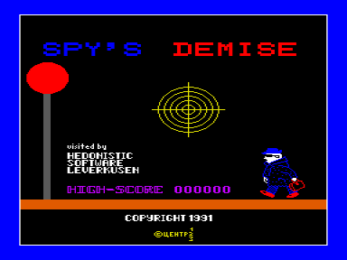
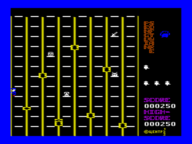

Spy’s Demise (Крах шпиона) - игра, опубликованная фирмой Penguin Software в 1983 году.
Изначально она была написана Аланом Зельдиным для компьютера Apple II.

Автор версии для Вектора неизвестен.
В файле можно увидеть пометку «JOYSTICK & KEYBOARD (C) 1991 TMK Soft (Киров)».

Очень хорошо сделанная музыка играет на ВИ53.
Сама игра идет с такой огромной скоростью, что пройти все этажи даже самого первого уровня практически невозможно.

Спасибо sergi at raregame.ru за редкую медленную версию игры.

См. также [Адскок](../adskok), [Пьяный лифтер](../plifter).

