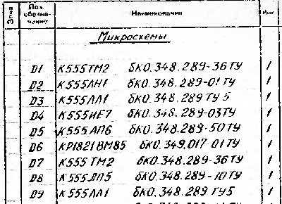

Спецификация ПК-6128Ц

## Перечень элементов

Расшифровка [скана спецификации](spec6128.djvu). Страницы с резисторами в файле расположены не по порядку: страница с R34–R78 следует после страницы с R79–R101.

### Конденсаторы

| Поз. обозначение | Наименование | Кол. |
|---|---|---:|
| C1 | К50-35-25В-22 мкФ-А, ОЖ0.464.214 ТУ | 1 |
| C2 | КМ-5А-М47-100 пФ ±10%, ОЖ0.460.161 ТУ | 1 |
| C3 | К50-35-25В-22 мкФ-А, ОЖ0.464.214 ТУ | 1 |
| C4 | К10-17-2Б-Н90-1,0 мкФ, ОЖ0.460.172 ТУ | 1 |
| C5 | К50-35-16В-220 мкФ-А, ОЖ0.464.214 ТУ | 1 |
| C6–C81 | КМ-5А-Н90-0,068 мкФ +80/−20%, ОЖ0.460.161 ТУ | 76 |
| C82 | К50-35-25В-22 мкФ-А, ОЖ0.464.214 ТУ | 1 |
| C83 | КМ-5А-Н90-0,068 мкФ +80/−20%, ОЖ0.460.161 ТУ | 1 |
| C84 | КМ-5А-Н90-0,15 мкФ +80/−20%, ОЖ0.460.161 ТУ | 1 |
| C85 | К10-17-2Б-М47-4700 пФ, ОЖ0.460.172 ТУ | 1 |
| C86 | К10-17-2Б-Н90-1,0 мкФ, ОЖ0.460.172 ТУ | 1 |
| C87 | КМ-5А-Н90-0,068 мкФ +80/−20%, ОЖ0.460.161 ТУ | 1 |
| C88 | КМ-5А-М47-100 пФ ±10%, ОЖ0.460.161 ТУ | 1 |
| C89 | К50-35-16В-47,0 мкФ-А, ОЖ0.464.214 ТУ | 1 |
| C90 | КМ-5А-М47-100 пФ ±10%, ОЖ0.460.161 ТУ | 1 |

### Микросхемы

| Поз. обозначение | Наименование | Кол. |
|---|---|---:|
| D1 | К555ТМ2, бК0.348.289-36 ТУ | 1 |
| D2 | К555ЛН1, бК0.348.289-01 ТУ | 1 |
| D3 | К555ЛЛ1, бК0.348.289 ТУ5 | 1 |
| D4 | К555ИЕ7, бК0.348.289-03 ТУ | 1 |
| D5 | К555АП6, бК0.348.289-50 ТУ | 1 |
| D6 | КР1821ВМ85, бК0.349.017-01 ТУ | 1 |
| D7 | К555ТМ2, бК0.348.289-36 ТУ | 1 |
| D8 | К555ЛП5, бК0.348.289-10 ТУ | 1 |
| D9 | К555ЛЛ1, бК0.348.289 ТУ5 | 1 |
| D10 | К155РЕ3, бК0.348.006-18 ТУ | 1 |
| D11 | К555ЛА3, бК0.348.466 ТУ1 | 1 |
| D12 | К555ИР22, бК0.348.289-20 ТУ | 1 |
| D13 | К555ЛН1, бК0.348.289-01 ТУ | 1 |
| D14 | К555ЛА3, бК0.348.466 ТУ1 | 1 |
| D15 | К561ИЕ10, бК0.348.457-04 ТУ | 1 |
| D16 | КР1561ЛИ2, бК0.348.794-04 ТУ | 1 |
| D17, D18 | К561ИЕ11, бК0.348.457-13 ТУ | 2 |
| D19 | К555ИД7, бК0.348.289 ТУ2 | 1 |
| D20 | К573РФ4А, бК0.348.422-04 ТУ | 1 |
| D21–D24 | К555КП2, бК0.348.289 ТУ2 | 4 |
| D25 | К555ИД4, бК0.348.466 ТУ6 | 1 |
| D26 | К573РФ4А, бК0.348.422-04 ТУ | 1 |
| D27–D42 | КР565РУ5Г, бК0.348.618 ТУ | 16 |
| D43, D44 | К555КП11, бК0.348.289-14 ТУ | 2 |
| D45–D48 | К555ИР10, бК0.348.466-58 ТУ | 4 |
| D49 | К555ТМ8, бК0.348.289-29 ТУ | 1 |
| D50 | К555ЛА3, бК0.348.466 ТУ1 | 1 |
| D51 | К555ЛЛ1, бК0.348.289 ТУ5 | 1 |
| D52 | К561ИЕ10, бК0.348.457 ТУ4 | 1 |
| D53 | К555ТМ2, бК0.348.289-36 ТУ | 1 |
| D54, D55 | К155РУ2, бК0.348.006-09 ТУ | 2 |
| D56, D57 | К555ЛН2, бК0.348.289 ТУ6 | 2 |
| D58 | К555ЛЛ1, бК0.348.289 ТУ5 | 1 |
| D59 | К555ЛЕ1, бК0.348.443-05 ТУ | 1 |
| D60, D61 | К555ТМ8, бК0.348.289-29 ТУ | 2 |
| D62 | К555ТМ2, бК0.348.289-36 ТУ | 1 |
| D63 | К555КП2, бК0.348.289 ТУ2 | 1 |
| D64 | КР580ВВ51А, бК0.348.745-03 ТУ | 1 |
| D65, D66 | К555АП3, бК0.348.289-50 ТУ | 2 |
| D67 | К555ЛА7, бК0.348.289-18 ТУ | 1 |
| D68 | К555АП3, бК0.348.289-50 ТУ | 1 |
| D69 | К555АП4, бК0.348.289-50 ТУ | 1 |
| D70 | К555ИЕ7, бК0.348.289-03 ТУ | 1 |
| D71 | К555ЛН1, бК0.348.289-01 ТУ | 1 |
| D72 | К555ТМ2, бК0.348.289-36 ТУ | 1 |
| D73 | К555ИЕ5, бК0.348.289-19 ТУ | 1 |
| D74 | КР1818ВГ93, бК0.348.877-08 ТУ | 1 |
| D75 | К555АГ3, бК0.348.289-36 ТУ | 1 |
| D76 | К555ИР16, бК0.348.289-03 ТУ | 1 |
| D77 | К555ЛН2, бК0.348.289 ТУ6 | 1 |
| D78 | КР580ВВ55А, бК0.348.745-02 ТУ | 1 |
| D79 | КР580ВИ53, бК0.348.745-10 ТУ | 1 |
| D80 | КР580ВВ55А, бК0.348.745-02 ТУ | 1 |
| D81 | К554СА3А, бК0.348.279-02 ТУ | 1 |
| D82 | К555ЛЛ1, бК0.348.289 ТУ5 | 1 |
| D83 | К293ЛП1Б, бК0.348.156 ТУ | 1 |

### Дроссель и резонаторы

| Поз. обозначение | Наименование | Кол. |
|---|---|---:|
| L1 | Дроссель высокочастотный ДПМ-0,1-100 ±5%, ПЕ0.477.006 ТУ | 1 |
| Q1 | Резонатор РК100КА-12БН-12000К-В, ОД0.338.006 ТУ | 1 |
| Q2 | Резонатор РК100КА-12БН-8000К-В, ОД0.338.006 ТУ | 1 |

### Резисторы

Если не указано иное: С2-23-0,125, ±10%, А-В-В-А, ОЖ0.467.104 ТУ.

| Поз. обозначение | Номинал или наименование | Кол. |
|---|---|---:|
| R1, R2 | 10 кОм | 2 |
| R3 | 820 Ом | 1 |
| R4 | 680 Ом | 1 |
| R5, R6 | 330 Ом | 2 |
| R7–R11 | 680 Ом | 5 |
| R12–R19 | 10 кОм | 8 |
| R20–R27 | 22 Ом | 8 |
| R28 | 75 Ом | 1 |
| R29 | 1,6 кОм | 1 |
| R30 | 680 Ом | 1 |
| R31 | 430 Ом | 1 |
| R32 | 1,6 кОм | 1 |
| R33 | 820 Ом | 1 |
| R34 | 430 Ом | 1 |
| R35 | 820 Ом | 1 |
| R36 | 430 Ом | 1 |
| R37 | 75 Ом | 1 |
| R38 | 430 Ом | 1 |
| R39 | 75 Ом | 1 |
| R40 | 430 Ом | 1 |
| R41 | 75 Ом | 1 |
| R42 | 430 Ом | 1 |
| R43 | СП3-16А-680 Ом ±10%-В, ОЖ0.468.363 ТУ | 1 |
| R44 | 430 Ом | 1 |
| R45 | СП3-16А-680 Ом ±10%-В, ОЖ0.468.363 ТУ | 1 |
| R46 | 36 Ом | 1 |
| R47 | 75 Ом | 1 |
| R48 | 5,1 кОм | 1 |
| R49 | 3,3 кОм | 1 |
| R50 | 1,6 кОм | 1 |
| R51 | 3,3 кОм | 1 |
| R52 | 1,6 кОм | 1 |
| R53 | 820 Ом | 1 |
| R54 | 5,1 кОм | 1 |
| R55 | 3,3 кОм | 1 |
| R56 | 150 Ом | 1 |
| R57–R74 | 10 кОм | 18 |
| R75 | 820 Ом | 1 |
| R76, R77 | 20 кОм | 2 |
| R78 | 430 Ом | 1 |
| R79 | 20 кОм | 1 |
| R80 | 5,6 кОм | 1 |
| R81 | 220 кОм | 1 |
| R82, R83 | 2,0 кОм | 2 |
| R84–R87 | 3,3 кОм | 4 |
| R88, R89 | 1,6 кОм | 2 |
| R90–R94 | 2,0 кОм | 5 |
| R95 | 51 кОм | 1 |
| R96, R97 | 10 кОм | 2 |
| R98–R101 | 2,0 кОм | 4 |

### Полупроводниковые приборы

| Поз. обозначение | Наименование | Кол. |
|---|---|---:|
| V1 | Диод КД521А, ЭР3.362.035 ТУ | 1 |
| V2 | Транзистор КТ315Б, ЖГ3.365.200 ТУ | 1 |
| V3 | Диод КД521А, ЭР3.362.035 ТУ | 1 |

### Соединители

| Поз. обозначение | Наименование | Кол. |
|---|---|---:|
| X1–X4 | Розетка ОНЦ-ВГ-4-7/16-Р, АШДК.434410.005 ТУ | 4 |
| X5 | Розетка ОНЦ-КГ-4-5/16-Р, АШДК.434430.010 ТУ | 1 |
| X6, X7 | Розетка СНП34С-30/27×9,4Р-22, БР0.364.106 ТУ | 2 |
| X8 | Вилка СНО53-60/93×9В-23-В, НЩ0.364.032 ТУ | 1 |
