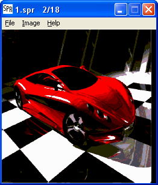

# SPRView

Программа [Ивана Городецкого](../../authors/ivagor) для просмотра и конвертирования графических форматов, в том числе форматов компьютера «Вектор-06Ц». В каталоге находится `SPRView.exe`; история изменений ниже описывает версии до 1.80.

## Поддерживаемые форматы

| Платформа или формат           | Расширение     | Возможности           | Ограничения                                                     |
| ------------------------------ | -------------- | --------------------- | --------------------------------------------------------------- |
| «Вектор»: редактор Draw        | `.spr`         | Просмотр и сохранение |                                                                 |
| «Вектор»: редактор «Карандаш»  | `.scr`         | Просмотр              | Поддерживается модификация PRSoft с палитрой в отдельном файле. |
| «Вектор»: редактор «Рембрандт» | `.rmb`, `.rbr` | Просмотр и сохранение |                                                                 |
| ZX Spectrum screen             | `.scr`         | Просмотр              | Длина файла — 6912 байт.                                        |
| Windows Bitmap                 | `.bmp`         | Просмотр и сохранение | 2 или 16 цветов; до 256 × 256 пикселей.                         |
| Portable Network Graphics      | `.png`         | Просмотр и сохранение | Не более 16 цветов; до 256 × 256 пикселей.                      |
| Graphics Interchange Format    | `.gif`         | Просмотр и сохранение | 16 цветов; до 256 × 256 пикселей.                               |
| ZSoft Paintbrush               | `.pcx`         | Просмотр              | 16 цветов; до 256 × 256 пикселей.                               |

В модификации формата «Карандаша» имя файла палитры записывается вместо телефона автора редактора. Такие файлы, например, создаёт утилита Романа Пантелеева `sav2scr` из дампа его эмулятора.

## Управление

| Клавиша   | Действие                                                     |
| --------- | ------------------------------------------------------------ |
| `A`       | О программе                                                  |
| `E`       | Выход                                                        |
| `O`       | Открыть изображение                                          |
| `S`       | Сохранить открытое изображение                               |
| `Z`       | Увеличить открытое изображение (Stretch)                     |
| `Shift+Z` | Увеличить изображение с билинейной фильтрацией (Smooth Zoom) |
| `Esc`     | Выйти из режима увеличения                                   |
| `←` / `→` | Предыдущее / следующее изображение в текущем каталоге        |

## Преобразование изображений

При сохранении в форматах «Вектора» SPR, RMB/RBR и GRF можно выбрать палитру (Palette) и метрику поиска цветов (Metric). По умолчанию используются палитра эмулятора Emu и метрика YCrCb; также доступна палитра Virtual Vector. Начиная с версии 1.80 внешние файлы уровней палитры `RG.lvl` и `B.lvl` не используются.

Команда **Image → Hudson decomposition** группирует тайлы изображения, сохранённого из эмулятора MSX Meisei, для последующего редактирования. Сначала изображение необходимо преобразовать в 16-цветный формат. По описанию автора, функция правильно работает с малобюджетными играми Hudson для MSX. Результат можно сохранить в файлах GRF (графика) и PAL (палитра) для компоновки с игрой для «Вектора».

## Скриншот

На скриншоте использована картинка, преобразованная в формат SPR Романом Пантелеевым.

## История изменений

- **1.80 — 16.10.2012:** выбор палитры и метрики при сохранении в форматы «Вектора»; удалена настройка палитры через `RG.lvl` и `B.lvl`. Палитры соответствуют Emu от 12.08.21 (Дмитрий Целиков, по умолчанию) и Virtual Vector 6.55 (Игорь Титарь); рекомендуемая метрика — YCrCb.
- **1.79 — 22.08.2010:** Hudson decomposition и сохранение результата в GRF и PAL.
- **1.77 — 16.04.2009:** настройка уровней синего через `B.lvl`, красного и зелёного через `RG.lvl`; файлы помещались рядом с программой. При отсутствии использовались уровни b2m. Прилагались варианты для b2m, Virtual Vector и fana. Эта возможность удалена в 1.80.
- **1.75 — 27.01.2009:** навигация по изображениям текущего каталога клавишами курсора.
- **1.74 — 27.01.2009:** добавлены горячие клавиши.
- **1.73 — 06.12.2007:** окна увеличения всегда открываются по центру; исправлен размер окна Smooth Zoom; Smooth Zoom ускорен более чем вдвое.
- **1.72 — 20.04.2003:** переработан Smooth Zoom: исправлена работа в режимах выше 640 × 480 и увеличена скорость.
- **1.71 — 12.01.2003:** исправлено открытие PNG, изменено сохранение и ускорен Smooth Zoom.
- **1.7 — 09.01.2003:** просмотр и сохранение PNG.
- **1.6 — 08.01.2003:** просмотр PCX.
- **1.5 — 07.01.2003:** просмотр и сохранение GIF; изменены определение типа изображения и палитра изображений Spectrum.
- **1.4 — 04.01.2003:** просмотр и сохранение «Рембрандта»; доработано увеличение. Автор отмечал, что на момент выпуска не имел изображений для проверки формата на PC.
- **1.3 — 02.01.2003:** просмотр изображений «Карандаша», включая модификацию PRSoft.
- **1.2 — 01.01.2003:** просмотр изображений ZX Spectrum и режимы увеличения Stretch и Smooth.
