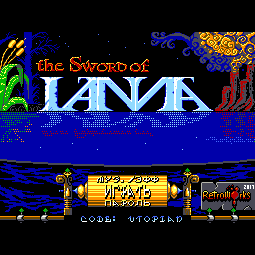
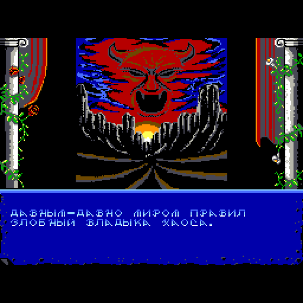
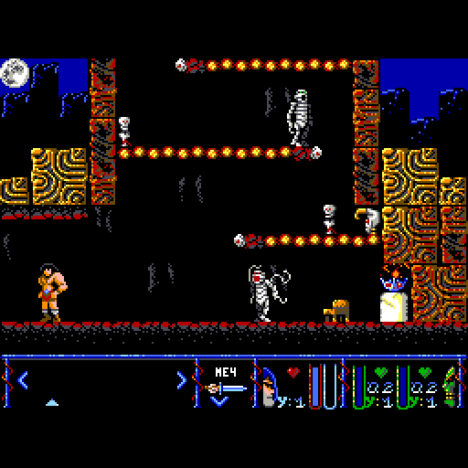
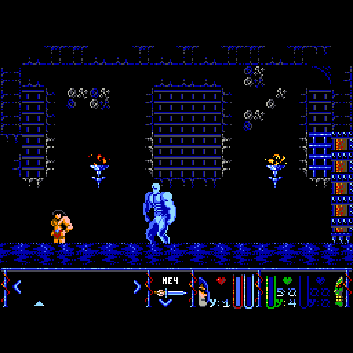
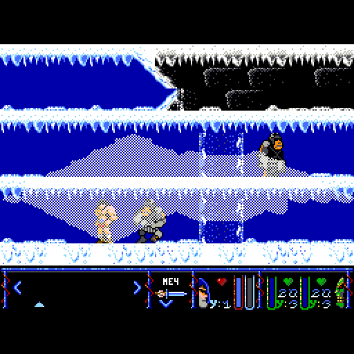
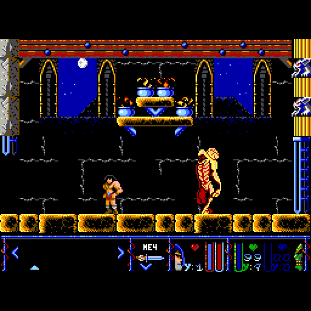

# The Sword of Ianna

Порт приключенческой игры The Sword of Ianna (RetroWorks, 2017, MSX2) на Вектор-06Ц, выполненный Борисом Лихачёвым. Меню, вступление и тексты уровней переведены на русский язык.

Игра требует 64 КБ ОЗУ, квазидиск 256 КБ и дисковод. Музыка и эффекты воспроизводятся через AY (порты `$14`/`$15`); без AY звучат только эффекты на ВИ53. Поддерживаются клавиатура и джойстик «П».

Дискета нужна на протяжении всей игры: уровни и слайды подгружаются с неё. На MiSTer подключите образ как дискету, дождитесь штатного ПЗУ и нажмите **Alt+F11**; в Emu80 вставьте дискету в привод A и нажмите **F12**.

На Векторе Турбо+ удерживайте РУС/ЛАТ при сбросе, выберите `FDD 0`, затем `IANNA.COM` и дважды нажмите ВК. Либо из CP/M 4.0 запустите `IANNA -V` с дискеты в приводе A. Игра занимает весь квазидиск: файлы на диске C: CP/M будут потеряны.

## Управление

Стрелки — движение, лестницы и прыжок; **пробел** или Z — удар; **СС** или X — действие; **ВК** или H — пауза и инвентарь. В инвентаре стрелки выбирают предмет, огонь применяет его, вниз меняет оружие, ВК возвращает в игру, АР2 выводит в главное меню. Джойстик «П» работает одновременно с клавиатурой.

## Состояние

В игре восемь уровней и секретный девятый, вступление и концовка. Версия 0.9.1 fix остаётся бета-версией: полное прохождение на железе не проверялось, музыки на ВИ53 нет. По данным автора, изменения fix проверены на стендах, но ещё не в Emu80 и на MiSTer; на Турбо+ звук не прослушан и теряется около 3 % кадровых прерываний.

## Скриншоты

| Меню              | Вступление               | Уровень 1                |
| ----------------- | ------------------------ | ------------------------ |
|  |  |  |

| Голем               | Уровень 3                | Уровень 8                |
| ------------------- | ------------------------ | ------------------------ |
|  |  |  |

Исходный код, подробное управление и инструкции по сборке — в [репозитории проекта](https://github.com/reqw41/ianna-v06c).
