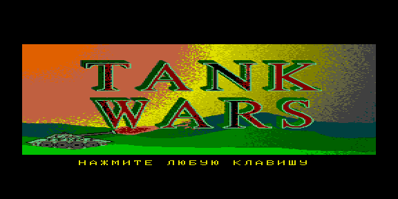

# Tank Wars

Порт артиллерийской игры Tank Wars 2.5 Кенни Морса для DOS на Вектор-06Ц.
Оригинал вышел в 1990 году.
От двух до четырёх танков по очереди стреляют друг в друга, выбирая угол и силу выстрела с учётом ветра.
За очки между раундами можно покупать оружие и защиту; среди противников могут быть люди и компьютерные игроки.

Версия для Вектора работает с 64 КБ памяти, использует звук на ВИ53 и содержит 18 видов оружия. Поле — 256×256 точек, 8 цветов; заставка — 16-цветная.

## Образы

- [Tank Wars 1.0 для Вектора-06Ц](TankWars-v06c-1.0.rom) — загрузка с адреса `0100h`, в том числе в эмуляторах и на MiSTer.
- [Tank Wars 1.0 для CP/M](TANKWARS.COM) — тот же файл для Вектора Турбо+, запуск командой `TANKWARS -V T3`.

После заставки нажмите любую клавишу; во время распаковки экран на несколько секунд станет чёрным.

## Управление

В настройках стрелки вверх и вниз выбирают строку, влево и вправо меняют значение, пробел или **ВК** начинает матч.

| Клавиша                | Действие                                          |
| ---------------------- | ------------------------------------------------- |
| Стрелки влево и вправо | Угол ствола                                       |
| Стрелки вверх и вниз   | Сила выстрела                                     |
| I                      | Развернуть ствол                                  |
| ТАБ или W / Q          | Следующее / предыдущее оружие                     |
| Пробел или ВК          | Огонь                                             |
| H / V                  | Включить купленное наведение                      |
| T                      | Выбрать цель наведения                            |
| АР2 / СТР              | Прервать раунд ничьей / победой случайного игрока |

## Скриншот

## Похожие игры

- [Tank War](../tankwar/) С. В. Барвиненко — другая игра с танковой дуэлью на Векторе-06Ц.

[Подробная инструкция](https://github.com/reqw41/tankwars-v06c/blob/v1.0/docs/MANUAL_RU.md), [исходный код проекта](https://github.com/reqw41/tankwars-v06c) и [релиз 1.0](https://github.com/reqw41/tankwars-v06c/releases/tag/v1.0).
