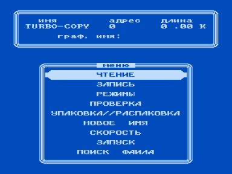
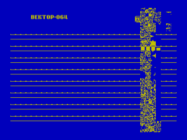

Копировщик с нестандартным форматом записи.

Примечание:

Спецформат TURBO поддерживается большинством начальных загрузчиков.

На втором скриншоте показан пример загрузки программы в формате TURBO.

TURBO-COPY использует метод ROM-автозапуска, упоминаемый в [Справочное руководство по компьютеру «Вектор-06Ц» (Черезов)](../cherezov).

См. также [FTT-Copy](../fttcopy).

