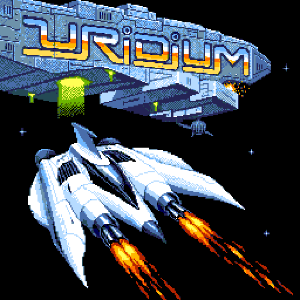
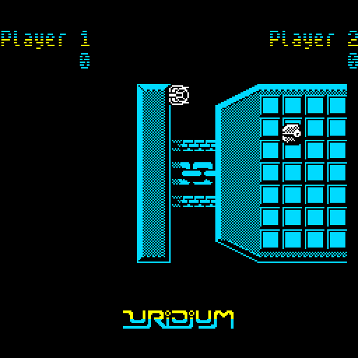

# Uridium

Порт космического скролл-шутера Andrew Braybrook, выпущенного Hewson Consultants в 1986 году. Версия для Вектора-06Ц перенесена с ZX Spectrum 48K, которую программировал Dominic Robinson: корабль игрока атакует вражеские дредноуты, пролетая над их поверхностью. В игре 15 уровней и режим для двух игроков по очереди.

Порт переведён с Z80 на КР580ВМ80А и работает на машине с 64 КБ памяти, без Z80-платы и квазидиска. Дредноут и спрайты выводятся в разных плоскостях без цветового клэша, звук и музыка воспроизводятся на ВИ53.

## Образы

Файлы из [релиза v0.5a](https://github.com/reqw41/uridium-v06c/releases/tag/v0.5a):

- [Uridium-v06c.r0m](Uridium-v06c.r0m) — образ для эмуляторов Emu80 и vector06js.
- [Uridium-v06c.c00](Uridium-v06c.c00) — тот же образ для ядра Vector-06C на MiSTer.

Образ размером 64 КБ загружается с адреса `0000h` и содержит заставку, титры и игру. Автор проверил порт в Emu80 и на стендах с ядром vector06js; на MiSTer и настоящем Векторе версия 0.5a не запускалась.

Это альфа-версия: темп несколько ниже и менее ровный, чем на ZX Spectrum, спрайты изредка мерцают; звёзды фона отсутствуют.

## Управление

На заставке нажмите любую клавишу; на титрах **1** или **2** выбирают число игроков, огонь начинает игру. Клавиатура и джойстик «П» работают одновременно.

| Клавиша     | Действие                                    |
| ----------- | ------------------------------------------- |
| Стрелки     | Полёт; влево и вправо — разворот и скорость |
| Пробел      | Огонь, начало игры                          |
| ВК          | Пауза                                       |
| АР2 в паузе | Выход на титры                              |
| F1 + F3     | Включить или выключить бесконечные жизни    |

## Скриншоты

## См. также

- [Chronos](../chronos/) — космический скролл-шутер.
- [Spacop](../spacop/) — вертикальный космический шутер.

Исходный код, инструкции по сборке и подробности порта — в [репозитории проекта](https://github.com/reqw41/uridium-v06c). Права на оригинальную игру и её материалы принадлежат соответствующим правообладателям.
