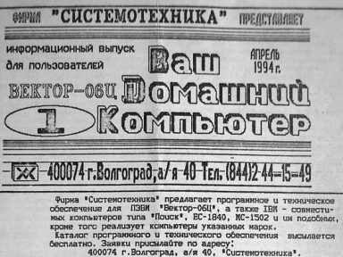

# Ваш домашний компьютер

Информационные выпуски для пользователей «Вектор-06Ц», издававшиеся фирмой «Системотехника» (Волгоград) в 1994 году. В архиве представлены шесть выпусков; четвёртый и пятый объединены.

Источник: домашний архив Evgenmak. [Оригинальный скан в формате DjVu](vdk.djvu).



## Текст выпусков

> Текст распознан со сканов и частично восстановлен. Возможны ошибки, особенно в числах, адресах, командах и листингах; перед использованием сверяйте их с оригиналом. Неразборчивые места отмечены, рисунки и схемы полностью не воспроизведены. Цены и контакты приведены как исторические сведения.

**Страницы:** [1](#страница-1) · [2](#страница-2) · [3](#страница-3) · [4](#страница-4) · [5](#страница-5) · [6](#страница-6) · [7](#страница-7) · [8](#страница-8) · [9](#страница-9) · [10](#страница-10) · [11](#страница-11) · [12](#страница-12) · [13](#страница-13) · [14](#страница-14) · [15](#страница-15) · [16](#страница-16) · [17](#страница-17) · [18](#страница-18) · [19](#страница-19) · [20](#страница-20) · [21](#страница-21) · [22](#страница-22) · [23](#страница-23) · [24](#страница-24)

## Страница 1

**Шапка (фирменный блок):**

Фирма **«СИСТЕМОТЕХНИКА»**

информационный выпуск для пользователей **«ВЕКТОР-06Ц»**

1994 г. · 400074 г. Волгоград, а/я-40 · тел. (8442) 44-15-19

> [рис.] Крупный декоративный логотип фирмы с надписью «СИСТЕМОТЕХНИКА» и стилизованным изображением компьютера.

**Фирма «Системотехника» предлагает** программное и техническое обеспечение для ПЭВМ «Вектор-06Ц», а также IBM-совместимых компьютеров типа «Поиск», ЕС-1840, МС-1502 и им подобных, кроме того реализует компьютеры указанных марок.

Каталог программного и технического обеспечения высылается бесплатно. Заявки присылайте по адресу: 400074 г. Волгоград, а/я 40, «Системотехника».

### Информация

В связи с широким распространением ПК «Вектор-06Ц» и нехваткой у пользователя информации по нему, фирма «Системотехника» осуществляет подписку на свои информационные выпуски, которые ориентированы и на новичков, давая основные понятия, и на опытных пользователей, затрагивая вопросы, которые ранее никто не поднимал. Только подписчики ВДК получат персональный ответ на свой вопрос на страницах ВДК.

Подписка производится круглый год, выпуски рассылаются по почте, поэтому текущая стоимость отражает стоимость типографских и почтовых услуг. Подписка включает в себя не менее 6-ти информационных выпусков и текущие каталоги. Стоимость подписки указывается в каталоге фирмы (до 1 мая — 3750 р.) или сообщается по Вашему запросу.

Для желающих или имеющих возможность фирма «Системотехника» предлагает для распространения выпуски «ВДК» со значительной скидкой. Мы также рассмотрим деловые предложения от предприимчивых людей по популяризации ПК «Вектор».

Хотим пояснить, что цена балла меняется. В каждом нашем каталоге указана текущая цена балла — до определенного срока (контроль по почтовому штемпелю). Новую цену балла можно узнать из следующего каталога или по телефону.

Если Вы делаете заказ на своих кассетах, обратите внимание на их качество, т.к. качество записи прямо зависит от качества кассет. Не присылайте очень старые кассеты или кассеты, уровень записи на которые резко отличается от уровня воспроизведения. Попробуйте сначала сами записать на нее любую программу.

### Библиотека программиста

#### Недокументированные команды микропроцессора КР580ВМ80

В любой технической документации по этому процессору напротив некоторых команд стоят прочерки, как будто этих команд не существует. На самом деле процессор все-же производит вполне определенные действия. Однако, результат выполнения этих команд нигде не описан.

Произошло это, видимо, потому, что эти команды дублируют уже существующие команды, и поэтому разработчики решили их не включать в описание команд.

Из приводимой таблицы видно, какие команды они дублируют.

| код | мнемоника |
| --- | --------- |
| 08  | NOP       |
| 10  | NOP       |
| 18  | NOP       |
| 20  | NOP       |
| 28  | NOP       |
| 30  | NOP       |
| 38  | NOP       |
| CB  | JMP addr  |
| D9  | RET       |
| DD  | CALL addr |
| ED  | CALL addr |
| FD  | CALL addr |

На первый взгляд может показаться, что такие команды и не нужны вовсе, однако одно существенное преимущество эти команды имеют: существующие отладчики не берут эти команды в расчет (как правило, они отрабатыва-

_(продолжение — на с. 2)_

---

## Страница 2

_(вверху — номер страницы: «ВДК 2»; продолжение статьи с. 1)_

ются, как команда NOP), а значит Вы можете их использовать для защиты своих программ от несанкционированного входа одних другими программистами.

### Новинка!

#### Начальный загрузчик версии 3.1

Существующая сейчас версия начального загрузчика имеет ряд недостатков, а именно:

- с его помощью очень трудно найти нужную программу при работе с магнитофоном;
- в процессе загрузки не видно, сколько еще загружаться программе.

Предлагаемая версия начального загрузчика навсегда решит проблему поиска нужной программы.

Процесс работы с магнитофоном будет выглядеть следующим образом:

- необходимо вставить магнитофонную кассету с записанными на ней программами в формате КОМ, при этом не важно перемотана кассета на начало или нет, и включить воспроизведение;
- загрузчик тут же выдаст на экран имя программы, стартовый, конечный и текущий адрес, т.е. на экране будет следующее:

  ```
  [рис.] экранная копия: имя программы — «КОЛОБОК» (в скане читается неуверенно: KOLOB…)
         адреса неразборчивы
  ```

- теперь известно, что загружается программа «Колобок», и пленка находится где-то на середине программы;
- если Вам необходима другая программа, то необходимо перемотать пленку в нужную сторону и включить магнитофон. Если найденная программа все та-же, то изменится только текущее положение курсора; если другая, то загрузчик напишет, какая это программа со всеми атрибутами;
- после того, как нужная программа найдена, находите ее начало и нажимаете ВВОД+БЛК. При загрузке программы имя, стартовый и конечный адрес будут отображены на экране, и Вы будете видеть, сколько еще загружаться программе.

Кроме этого, в предлагаемой версии начального загрузчика устранен еще один недостаток предыдущих версий.

Может быть Вам приходилось попадать в ситуацию, когда у Вашего знакомого кассета загружается, а у Вас нет, хотя, вроде, и головку подстраивали, и кассета хорошая, и магнитофон не плохой...

Дело тут действительно, частично в магнитофоне, но и в загрузчике тоже. Магнитофон, как известно, аналоговое устройство, и напрямую записать цифровой сигнал нельзя. Для этого сигнал кодуруют, в данном случае, частотной модуляцией (подробнее смотри в справочнике Черезова А.Ю.). Существующие загрузчики (да и копировщики) определяют скорость чтения по одной полуволне кодированного сигнала, а другая половина пропускается. Но, так как во многих «Векторах» стоит на входе компаратор, то время прохождения 1 и 0 может быть различно. Сказанное можно проиллюстрировать схемой:

```
[рис.] осциллограммы: «идеальный сигнал» и «реальный сигнал»
```

Поэтому при определении скорости может возникать ошибка.

Предлагаемый загрузчик определяет скорость по сумме положительной и отрицательной части кодированного байта, что позволило увеличить скорость записи и воспроизведения (на моем компьютере обычный загрузчик может загрузить программу на скорости не ниже 1.5 (стандартная скорость 3.2), предлагаемый загрузчик уверенно работает на 10).

Кроме загрузки с магнитофона загрузчик может осуществлять загрузку с электронного диска, дисковода и внешнего ПЗУ. Загрузка с дисковода также модифицирована по сравнению с Кишиневским стандартом.

Для тех, кто не решается самостоятельно менять ПЗУ начального загрузчика, хотя это достаточно просто (необходимо удалить предыдущую микросхему, перекинуть несколько проводков и впаять новую), предлагаем программу `LOADER`, которая занимает объем 5 блоков и имеет те же функции, что и начальный загрузчик в области загрузки с магнитофона. Запустив программу `LOADER`, Вы сможете найти интересующую Вас программу и, если Ваш загрузчик работает плохо, то можно запустить программу, загрузив ее в `LOADER`, нажав РУС/LAT.

Аналогичными возможностями обладает программа `NAME`, но принципы загрузки и внешнее оформление другие.

Отзывы и предложения по работе программ начального загрузчика и `LOADER` направляйте по адресу фирмы «Системотехника» автору этих программ — `[неразборчиво]` В.И.

---

## Страница 3

_(вверху — номер страницы: «ВДК»)_

### Разное

#### Небольшие пояснения

На данный момент у нас в стране существует несколько фирм, а также великое множество частных лиц, занимающихся распространением программ для различных бытовых компьютеров, и в частности для «Вектора». В том числе, очевидно, не безизвестная Вам, фирма «Сотан». Надо отдать им должное, отдельные игровые программы, разработанные программистами, работающими под крылом этой фирмы, выглядят любопытно. Однако, нас беспокоит другое. Фирма «Сотан» продолжает выпускать и рекламировать контроллер дисковода, не совместимый по формату дискет с базовой Кишиневской версией. В связи с этим, у нас возникло желание несколько прояснить ситуацию, касающуюся этих изделий вообще.

Этот контроллер размечает дискету на 630 Кб (Кишиневский на 800 Кб), кроме того он не работает с операционной системой Микродос (МДОС), обслуживается совершенно бредовыми операционными системами (ОС) типа CP/M-53 [так в тексте; цифры читаются неуверенно] и т.п. Ни один пользователь, а тем более программист, поработавший в Микродосе, никогда не согласится на эти подделки под фирменную CP/M-80, а Микродос практически полностью с неё совместима. В МДОС работают языки высокого уровня, электронные таблицы, базы данных, игрушки, предназначенные для работы в CP/M-80. Контроллер, работающий с МДОС, свободно читает дискеты с CP/M компьютеров, таких как ROBOTRON и им подобных. Утверждения «Сотан», что их контроллер надежнее читает информацию, совершенно не обоснованы.

Но даже все приведенные аргументы, а именно:

- на 20% большая емкость дискеты;
- удобство операционной системы;
- совместимость с CP/M-80 по формату записи на диск;
- совместимость программного обеспечения;

меркнут перед тем, что Микродос v2.0 поддерживает электронный диск («ЭД»). Мы в своих выпусках еще коснемся подробного описания ЭД. Для тех, кто слышит это название впервые, сообщаем, что ЭД (иногда его называют квазидиском) — это модуль расширения оперативной памяти емкостью 256 Кб, доступ к которому может быть организован либо как к дополнительному дисководу, либо как к просто ОЗУ.

Таким образом, в Микродосе появляется еще одно дисковое устройство C:.

«Сотан» игнорирует все преимущества ЭД и даже публично пытался доказать в одной из своих газет, что за те деньги, которые необходимо заплатить за ЭД, лучше приобрести дискету, и это будет выгоднее по объёму хранимой из них информации. Мы хотим отметить, что в этом случае, не смотря на свои другие заслуги, «Сотан» просто морочит голову своим читателям с целью привлечения их под знамена своего контроллера и убогих операционных систем.

Вы должны понимать, что расширение ОЗУ компьютера характеризуется не просто увеличением килобайтов, а переводом его на новый уровень, в новую весовую категорию. И уже сейчас имеются программы и ведутся разработки новых программ, как игровых, так и прикладных, которые непосредственно используют ЭД, что обеспечивает им большие преимущества. Например, при использовании ЭД появляется возможность подключать в экранное ОЗУ компьютера память с ЭД. За счет этого можно создавать сложные игровые экраны и быстро их менять или, например, сделать отладчик программы, который будет позволять переключаться между графическим и текстовым экранами, т.е. Вы сразу сможете посмотреть, что именно написанная Вами ассемблерная программа нарисует на экране в графике.

Нельзя не учитывать и такого преимущества ЭД, как быстродействие. Действительно, обмен информацией с ним происходит на порядок быстрее, чем с НГМД. Вы скажете, что Вам достаточно и скорость работы с гибким диском (особенно по сравнению с магнитофоном). Конечно, если загружать только игровые программы, то Вы правы. Но если Вы занимаетесь разработкой программ, особенно на ассемблере, то знаете, что очень часто при отладке программы «высыпаются» и портят ОС, поэтому приходится перезагружаться, делать изменения в программе, записывать ее на диск, компилировать, запускать и снова перезагружаться.

При работе с дисководом эта последовательность действий весьма утомляет. Пока загрузится система, потом редактор, потом программа и т.д. Дисковод «елозит» по дискете довольно долго. В то время, как ОС и все рабочие программы Вы можете записать на ЭД и работать только с ним, а только в конце работы сбросить последнюю версию программы на гибкий диск. Это не только удобнее, но и уменьшает износ дисковода.

При работе часто (значительно чаще, чем это может показаться на первый взгляд) возникает необходимость копирования дискет (хотя бы для создания дубликатов). Используя только контроллер, Вы замучаетесь переставлять дискеты. В этом случае «Сотан» предлагает Вам обзавестись еще одним дисководом. И получится, что это-

_(продолжение — на с. 4)_

---

## Страница 4

_(вверху — номер страницы: «ВДК 4»)_

рой дисковод все основное время будет простаивать. Эту проблему также поможет Вам решить ЭД. С его помощью Вы скопируете дискету всего в три приема, а стоимость ЭД и дисковода в настоящее время примерно одинаковы — 50-60 тыс. руб.

После всего сказанного, как нам кажется, остается один аргумент в пользу контроллера «Сотан» — это его относительно низкая цена, примерно в 1.5 раза (в зависимости от комплектности поставки и формы оплаты) меньше, чем у нас и у аналогичных нам фирм, распространяющих стандартные контроллеры. Ну, это понятно, т.к. «Сотан» находится в Москве, т.е. в непосредственной близости от рынка радиодеталей, и комплектация достается им значительно дешевле.

Так что дело за Вами, дорогие читатели. Определите сами, настолько ли Вы богаты, чтобы покупать дешевые контроллеры.

Данная статья не имеет своей целью опорочить фирму «Сотан» и ее контроллеры, а дает Вам пищу для размышлений, чтобы Вы действительно выбрали то, что Вас больше устраивает.

### Об упаковщике `PRESS.COM` v2.1

Информация для владельцев «Вектора» в дисковом варианте: стартовый адрес программы 8400H.

Заметим также, что программа не работает в среде Микродос, а только в Мониторе, версия работающая в ОС появится в следующем каталоге.

### Технические подробности

Много неприятностей пользователям «Вектора» доставляют проявляющиеся на экранах некоторых типов телевизоров и мониторов линии обратного хода лучей. Появление этих линий обусловлено особенностями работы схемы «Вектора» и отсутствием или плохой настройкой схемы гашения обратного хода луча в Вашем мониторе или телевизоре. Можно, конечно, попробовать доработать данную схему в телевизоре, чтобы она полностью выполняла свои функции при работе с «Вектором». Однако, зачастую, это оказывается весьма сложно, а то и вообще не возможно. Таким образом, Вы можете потерять время и так ничего и не добиться. Мы хотим предложить Вам другой способ, который позволит раз и навсегда избавиться от этой проблемы. Для этого необходимо произвести небольшую доработку самого компьютера. Доработка очень простая и для ее осуществления не требуется ни специальных знаний, ни дефицитных деталей.

```
[рис.] Принципиальная схема: транзистор КТ315 (структура n-p-n),
        резистор в цепи базы 1.5 кОм, нагрузочный резистор 100 Ом.
        Подписи на схеме частично неразборчивы.
```

Данная схема избавит Вас от линий обратного хода на любых черно-белых телевизорах и мониторах. Схему гашения линий обратного хода для цветных телевизоров мы опубликуем в следующем выпуске ВДК.

Последовательность действий при установке данной схемы следующая:

- выпаять из платы компьютера одну ножку резистора R34, ближнюю к Вам, если Вы смотрите на компьютер спереди (по схеме эта ножка резистора R34 соединяется с резистором регулировки контрастности R37), и припаять ее к коллектору транзистора КТ315;
- эмиттер транзистора КТ315 припаять на землю;
- на базу транзистора, через резистор 1.5 кОм, подать сигнал с микросхемы D8 (К155ТМ2) с 9-ой ножки;
- параллельно резистору R19 припаять резистор сопротивлением 100 Ом.

### Вопрос-ответ

**Для чего нужен файл `INITIAL.SUB`?**

Эта программа представляет собой командный файл, который выполняется автоматически сразу после загрузки операционной системы Микродос, и может содержать любые команды данной ОС.

Его обычно используют для переустановки текущих параметров ОС. Программа `INITIAL.SUB` подготавливается в любом текстовом редакторе и обычно содержит следующие строки:

```
0 74 F ;установка цвета
0 C1   ;установка режима принтера
0 5A A ;установка обмена с консолью
       ;в кодировке КОИ8
```

> Числа и буквы в первых двух командах читаются в скане неуверенно.

Заметим, что установить кодировку КОИ8 (без изображения псевдографикой знаков и цифр) можно установить только если указанная выше команда будет записана в файл `INITIAL.SUB`.

400074 г. Волгоград, а/я 40
фирма «Системотехника».

---

## Страница 5

**Шапка (фирменный блок):**

Фирма **«СИСТЕМОТЕХНИКА»** · информационный выпуск для пользователей **«ВЕКТОР-06Ц»**
400074 г. Волгоград, а/я-40 · тел. (8442) 44-15-19

> [рис.] Логотип фирмы; ниже — знак с надписью «Компьютер».

### Информация

Уважаемые подписчики ВДК! Мы стараемся ответить на любой ваш вопрос, касающийся эксплуатации ПК «Вектор-06Ц» и тонкостей работы программного обеспечения, однако, если Вы задаете нам вопрос, то пользуйтесь общеизвестными понятиями и определениями. Для ответа не забывайте вкладывать конверт. На наиболее интересные запросы ответы будут даны в № ВДК.

### Библиотека программиста

#### Перекодировщик

В некоторых случаях при подключении принтера на печать выводятся не те символы, которые отображены на экране. Это вызвано тем, что кодовая таблица принтера не совпадает с таблицей кодов знакогенератора используемой программы. Это можно исправить, если внести изменения в программу вывода символа на принтер.

Суть вносимых изменений проста: необходимо перехватить обращение к принтеру в момент выдачи на него того или иного кода, перекодировать байт в нужную кодировку и отправить его дальше.

Как это можно сделать практически? Известно, что в «Векторе» обращение к принтеру происходит через управляющие порты 04-07. Программа выдачи байта может выглядеть так:

```asm
        MVI A,M        ; выдача байта на
        OUT 07         ; принтер
        MVI A,0EEH     ; передача
        OUT 05         ; стробирующего
        MVI A,0FEH     ; импульса
        OUT 05
```

Необходимо найти команду `OUT 07` в интересующей Вас программе, вместо которой и будет вызываться «своя» подпрограмма обработки кода, после чего программа будет выглядеть так:

```asm
                CALL DRIVER
                MVI A,0EEH     ; передача
                OUT 05         ; стробирующего
                MVI A,0FEH     ; импульса
                OUT 05
DRIVER:         MVI A,M        ; пересылка в ак-
                               ; кумулятор выво-
                               ; димого байта
                PUSH H         ; сохранение в
                               ; стеке регистров
                               ; H
                MVI H,TABLE    ; установка стар-
                               ; шего байта таб-
                               ; лицы перекоди-
                               ; ровки
                MOV B,A        ; младший байт
                               ; таблицы переко-
                               ; дировки
                MOV A,M        ; новый байт счи-
                               ; тываем из таб-
                               ; лицы
                POP H          ; возвращаем зна-
                               ; чение регистров
                               ; H
                OUT 07         ; вывод нового
                               ; байта на печать
```

> Имя метки `DRIVER` в скане читается плохо (латиница; возможно «ORIVER»); по смыслу — подпрограмма-драйвер.

Осталось только подготовить собственно таблицу перекодировки и выбрать место, где она будет располагаться. Например, если в программе свободны адреса 7000H-70FFH, то по ним можно разместить новую таблицу знакогенератора. Значение метки `TABLE` в этом случае будет равно 70H, а таблица может выглядеть так:

```
7000H   00 01 02 03 04 05 06 07
7008H   08 09 0A 0B 0C 0D 0E 0F
…
7078H   78 79 7A 7B 7C 7D 7E 7F
7080H   80 81 82 83 84 85 86 87
…
70E0H   08 09 0A 0B 0C 0D 0E 0F
```

> Значения последней строки (адрес и байты) читаются в скане неуверенно.

где до адреса 7080H располагаются коды латинских, а далее русских букв. Теперь если на принтер выводится байт 81H, то после перекодировки на принтер будет выведен байт B1H. Символы с кодами до 80H, как правило, нет необходимости перекодировать, т.к. это стандартная часть для всех таблиц

_(продолжение — на с. 6)_

---

## Страница 6

_(вверху — колонтитул: «ВДК „Системотехника“»)_

знакогенераторов. Поэтому в таблице по адресам с 7000H до 7080H стоят те же значения, что и посылаемые на принтер самой программой. Как видите, сам процесс перекодировки не сложен, вся сложность заключается именно в поиске обращения к устройству, которое Вам необходимо перехватить, размещении таблицы перекодировки и самой программы.

Приведенный выше пример элементарен. Поняв его работу, Вы можете сами написать настоящий универсальный драйвер для принтера или любого другого внешнего устройства.

### Работаем в Микродос

Ни для кого не секрет, что среди обладателей дискового варианта «Вектора» абсолютное большинство составляют пользователи, работающие с операционной системой Микродос. Микродос — это самая мощная и универсальная ОС работающая с «Вектором-06Ц». Далее мы приводим небольшие описания системных и прикладных программ, работающих в этой широко распространенной среде.

#### Какую оболочку предпочесть?

В среде Микродос в настоящее время существуют три оболочки типа Norton Commander — `PC.COM`, `ASC.COM`, `NC.COM` — т.е. такие программы, с помощью которых пользователи просматривают каталоги, копируют, переименовывают, удаляют файлы, запускают программы и т.д.

`PC.COM` — самая первая оболочка, появившаяся на Векторе еще в 1991 г. Программа надежна в эксплуатации, с ее помощью можно удалять, переименовывать файлы, отмечать необходимые программы для копирования, есть возможность отключения панелей, вывод в командную строку имени файла. В случае сбоя при чтении или записи вместо имен файлов в панелях появятся символы Е. Для восстановления работоспособности необходимо подать команду восстановления (клавиши УС+К).

Недостатком программы является медленный сдвиг файлов в панелях. Обязательно наличие квазидиска и ОС Микродос версии 3.0.

Главной особенностью оболочки `ASC.COM` является наличие в ней встроенного редактора ВЕТЕХ, использование крупного алфавита обеспечивает читаемость текста даже на цветных мониторах с плохой разрешающей способностью. При нажатии клавиши «СС» меню подменяется.

> Название редактора (ВЕТЕХ) в скане читается по буквам уверенно, но само написание может быть латиницей.

Программа позволяет копировать или удалять группы файлов, при этом на экране показывается размер программы или размер отмеченной группы файлов, а также размер использованного и свободного дискового пространства. Оболочка может выводить в командную строку название файла из панели, что позволяет запускать любые программы, требующие для своей работы еще одной программы. Имеется возможность выбора номера пользователя. Программа работает в любой версии ОС Микродос и требует наличие квазидиска.

`NC.COM` обладает очень широким сервисом. Если при входе в программу выбрать режим с изменением BIOS, то на экране появятся системные часы, которые при необходимости можно переустанавливать, заметим, что часы не пропадают после выхода из программы. Кроме возможности удаления, копирования, просмотра размера файла или группы отмеченных файлов, размера свободного и занятого дискового пространства есть возможность верификации дискеты, вывод на экран файлов по шаблону, вывод на экран в кодах ASCII, вывод на принтер. При вводе в командную строку имени файла из панели и последующего запуска этой программы другой программой происходит передача управления этой программе, по окончании работы происходит возврат в `NC.COM`. Сдвиг файлов в панелях происходит очень быстро. Для своей работы программа требует наличие квазидиска и ОС Микродос версии 3.0.

### Знаете ли Вы?

_Устинский Я.Д., г. Салават_

**Сведения об игре «Zodiak strip».**

В этой игре можно достигнуть желаемого, если на запрос о цифре нажать одновременно клавиши УС и «пробел», тогда девушка сразу примет надлежащий вид.

### Технические подробности

#### Восстановление цветов

При подключении «Вектора-06Ц» к телевизорам типа ЗУСЦТ и аналогичным, использующим модуль цветности МЦ-31 (на м/с К174КА1Т), изображение на экране телевизора представляется в инверсных цветах. Чтобы устранить этот недостаток необходимо на каждый цветовой сиг-

_(продолжение — на с. 7)_

---

## Страница 7

_(вверху — колонтитул: «ВДК „Системотехника“»)_

нал поставить по инвертору. Они могут быть собраны по приведенной ниже схеме. При этом в МЦ-31 необходимо удалить четыре резистора, которые идут от разъема для подключения компьютера на землю и имеют номиналы по 75 Ом.

> Номинал читается неоднозначно (73/75/78 Ом) — на скане вторая цифра смазана.

```
[рис.] Принципиальная схема инвертора (транзистор, резисторы);
        подписи на схеме: «К2/3», «К2/1», «+5В», «общий», «6.2к», «250м» —
        читаются частично.
```

Возможно, при выполнении этой операции будут нарушены некоторые дорожки, их необходимо восстановить перемычками. В качестве направляющих, которые приклеиваются в технологическое отверстие ползунка, лучше использовать пластмассовые трубочки. Отверстия в поролоновом демпфере необходимо пробивать, а не прожигать. При аккуратном исполнении, данная доделка очень проста.

```
[рис.] Чертеж клавиши/ползунка клавиатуры с размерами и выносными линиями;
        подписи («направляющая», размеры в мм) читаются частично.
```

### Усовершенствование клавиатуры

Стремление усовершенствовать компьютер, а именно, заменить или сделать герконовую клавиатуру, требует значительных затрат, а при сборке и настройке — терпения.

Между тем, многие, даже профессиональные компьютеры имеют контактные клавиатуры, которые тем не менее работают надежно. Все зависит от того, как они реализованы, и на «Векторе» далеко не худший вариант, легко поддающийся модернизации. Предлагаемый способ был опробован и дал неплохой результат. Он устраняет перекос при нажатии клавиш, фольга равномерно прилегает к контактным площадкам на плате, устраняется дребезг контактов, залипание и скрип клавиш. Переделка обратима и может быть прекращена на любом этапе.

Суть предложения ясна из приведенного рисунка. При сверлении отверстия в клавише целесообразно воспользоваться кондуктором, чтобы получить отверстие строго по центру.

### Устранение цветных линий обратного хода

Как и обещали в прошлом номере ВДК, ниже приводим схему гашения линий обратного хода лучей, которые могут появляться на цветном телевизоре или мониторе.

Работа этой схемы аналогична схеме, приведенной в прошлом номере. Как правило, достаточно установки ее в Ваш компьютер, чтобы полностью избавиться от обратного хода на цветном телевизоре. Однако, она не избавит Вас от линий обратного хода на ч/б мониторе. Поэтому, чтобы навсегда забыть об этом явлении, можно установить обе схемы.

```
[рис.] Принципиальная схема гашения линий обратного хода для цветного
        телевизора; видны обозначения «+5В», «+12В», «340-920», «К2/3», «К2/1»,
        номиналы элементов в основном неразборчивы.
```

---

## Страница 8

_(вверху — колонтитул: «ВДК»)_

### Вопрос-ответ

**Расскажите о дисковых копировщиках.**

Программа 6.91 `DC.COM` (разработка 1993 г.) позволяет копировать диск в диск на одном дисководе или на 2-х дисководах без квазидиска.

> Первая буква имени файла (`DC.COM` / `DS.COM` / `OC.COM`) в скане неоднозначна.

При этом, если один из дисков формата «COMAN», а другой «МикроДос», программа это автоматически определит и будет копировать из формата COMAN в МикроДос автоматически и полностью, а при копировании из формата МикроДос в COMAN скопируются только первые 640 Кб, т.к. в формате COMAN больше не помещается на дискету. При копировании на экран выводятся две панели, процесс копирования происходит по несколько дорожек, в случае ошибки чтения можно повторить чтение или перейти на следующую дорожку.

Программа 6.82 `DISKCOPY.COM` копирует только диски МикроДос на 2-х дисководах с проверкой или без проверки копирования, копирование происходит подорожечно. Запуск программы без ключей — копирование с А: на В: с проверкой копирования. При запуске `DISKCOPY A:` происходит копирование с дисковода В: на дисковод А: без проверки копирования.

**Почему после запуска программой `RUN.COM` некоторых программ на Бейсике на экране появляются «пустые» строки и все?**

Данные Бейсик-программы не содержат в себе команды установки цвета `SCREEN 0`, поэтому после запуска таких программ при появлении пустых строк необходимо нажать клавиши БЛК+СБР и вслепую набрать `COLOR 15`, после чего появится приглашение Бейсика. Для запуска программы необходимо набрать `RUN`. Заметим, что программа «Русский Бейсик» `BASIC0.COM` сама устанавливает цветовую палитру, и все программы будут работать сразу.

> Фрагмент `COLOR 15` и имя `BASIC0.COM` прочитаны по скану с неуверенностью; в исходном тексте строка команды содержит также служебные символы, не различимые на скане.

**Что такое МВПЗУ?**

Если Вы используете компьютер не только для игр, но и для программирования или решения различных прикладных задач и по каким-то причинам не можете приобрести контроллер дисковода и дисковод, то Ваше спасение заключается в модуле внешнего постоянного запоминающего устройства МВПЗУ.

МВПЗУ представляет собой небольшую печатную плату, на которой размещены четыре панельки, рассчитанные под установку микросхем серии К575РФ4 или `[неразборчиво]` или их зарубежного аналога. Каждая такая м/с имеет емкость 8 Кб, т.е. общая емкость МВПЗУ, когда заполнены все четыре м/с, составляет 32 Кб. МВПЗУ подключается [к] контактному разъему «ПЗУ», для чего на плате МВПЗУ имеется соответствующий разъем. Таким образом, Вам достаточно приобрести один модуль, а в дальнейшем приобретать только м/с, в которых записаны интересующие Вас программы.

Устанавливая на панельки различные комплекты м/с, Вы имеете возможность быстро загружать в компьютер интересующие Вас пакеты программ. Наибольшей популярностью для записи в м/с модуля пользуются следующие программы: Basic v2.5 (помещается в двух м/с), Монитор-монстр (в 2-х м/с), ВЕТЕХ (в 1-й м/с), Микродос (в 2-х м/с), Карандаш (в 3-х м/с). Возможна запись любых других программ, в том числе игрушек.

Загрузка с МВПЗУ возможна двумя способами:

а) без переделки Вектора-06Ц. При этом сначала с магнитофона загружается короткая программа, после запуска которой происходит моментальная загрузка большой программы с МВПЗУ;

б) с заменой м/с ПЗУ начальной загрузки внутри компьютера. В этом случае загрузка происходит моментально при нажатии клавиш ВВОД+БЛК.

Не надо бояться менять м/с начальной загрузки в компьютере, т.к. мы прилагаем подробную инструкцию, описывающую, как это сделать. Кроме того заказав у нас новое супер ПЗУ начальной загрузки, которое было описано в первом номере ВДК (пункт 6.6 каталога), Вы также облегчите себе работу с магнитофоном. Если «Вектор» был выпущен недавно, то в нем уже может быть установлен загрузчик, обеспечивающий работу с МВПЗУ.

Работа с МВПЗУ выглядит следующим образом: после нажатия клавиш ВВОД+БЛК на экране мгновенно заполняются кубиками четыре строчки карты загрузки (если установлены только две м/с, то две строчки), после чего надо нажать СБР+БЛК. На экране появится надпись `ПЗУ №1,2,3,4`. Необходимо нажать клавишу с номером соответствующим номеру м/с ПЗУ, в которой находится начало запускаемой Вами программы. Так если в Вашем модуле установлены м/с с Бейсиком и Монитором, то после нажатия клавиши «1» Вы выйдете в Монитор, а после нажатия клавиши «3» — в Бейсик, т.к. каждая из этих программ занимает по две м/с.

Как Вы можете заметить, стоимость модуля значительно ниже, чем его потребительские качества.

---

Фирма «Системотехника» предлагает широкий выбор программного обеспечения, контроллеры дисководов, электронные диски, МВПЗУ, справочники и документацию для компьютера «Вектор-06Ц», а также сами компьютеры.

Каталог высылается бесплатно.

---

## Страница 9

**Шапка в рамке (вверху полосы):**

> «СИСТЕМОТЕХНИКА» представляет
> информационный выпуск для пользователей ВЕКТОР-06Ц
> **ИЮЛЬ 1994 г.**
> 400074, г. Волгоград, а/я 40, тел. (8442) 44-15-40
> `[часть строк шапки набрана вывороткой; индекс и номер телефона читаются неуверенно]`

### Информация

В этом году всего выйдет 6 выпусков ВДК. Стоимость подписки на этот год составляет 4000 руб. В следующем 1995 г. выпуски станут выходить каждый месяц, а возможно и чаще, это зависит от Вас. Мы планируем увеличить так же и объем выпусков. Пишите нам, какую информацию Вы хотели бы увидеть на наших страницах. Если есть какие-либо идеи, разработки, опыт, предложения, которыми не жалко поделиться с остальными пользователями «Вектора», пишите, и если они окажутся интересными, мы их обязательно опубликуем.

Мы также намерены провести ряд мероприятий, направленных на популяризацию «Вектора», и делаем это совершенно искренне, т.к. глубоко убеждены, что на сегодняшний день «Вектор» является лучшим из существующих у нас в стране недорогих компьютеров этого класса, а недостатки существующего программного обеспечения являются результатом сложного положения с коммерческим программированием, но никак не результатом аппаратных недостатков этой машины. Настало время «Вектору» засунуть за пояс все эти «Денди» и прочую ерунду, рассчитанную на людей, которые, кроме того чтобы сообразить, как воткнуть картридж в дырку, больше ни на что не способны.

### Библиотека программиста

_© Copyright 1994 by Braze corp._ `[название фирмы в строке копирайта читается неуверенно]`
_Омск. Шацков Вячеслав._

#### Работа системной шины

Поводом к написанию этой статьи послужили работы Омского центра программирования по установке в «Вектор» `[неразборчиво]` машины процессора Zilog. Естественно, при этом хотелось `[неразборчиво]` быстродействие компьютера `[неразборчиво]` того, что Z80 может работать на тактовой частоте вплоть до 12 МГц.

_(продолжение — в правой колонке этой же полосы)_

Для этого необходимо понять, как в «Векторе» решена проблема взаимодействия процессора и видеоадаптера при обращении к ОЗУ. Для обеспечения взаимодействия ОЗУ, ПЗУ, микропроцессора и видеоадаптера служит системная шина. В первом приближении это комплекс проводов, передающих различные сигналы, и устройство управления. Именно оно определяет эффективность использования ресурсов машины.

Работа системной шины в «Векторе» организована по циклам. Различают два вида цикла шины: цикл с обращением процессора и цикл без обращения процессора. Каждый цикл разбивается на 4 такта, а такт, в свою очередь, на 4 четверти. Длительность одного такта составляет 1 период тактовой частоты процессора (3 МГц на «Векторе»). Рассмотрим работу системной шины по тактам. Первый такт любого цикла шины — такт обращения видеоадаптера. Устройство управления вырабатывает сигнал переключения шины так, что на адресные входы ОЗУ приходит адрес, сформированный видеоадаптером. В конце такта информация, считанная из ОЗУ, заносится в регистры сдвига и затем точка за точкой выводится на экран в течение всего цикла шины.

Второй такт цикла шины служит для приведения ее в исходное состояние для обращения процессора. В конце такта процессор, в случае обращения к ОЗУ, выдает сигнал MREQ. В ответ на это устройство управления формирует сигнал ПЕР, который выбирает тип остальных тактов цикла, как тактов с обращением процессора. Если же сигнал MREQ не был выставлен, то шина обрабатывает цикл без обращения процессора.

Во время 3-го и 4-го такта цикла без обращения процессора шина отрабатывает холостые такты, никакие операции не производятся.

Во время 3-го такта цикла с обращением процессора (это соответствует второму такту микропроцессора) на микросхемы ОЗУ выдается адрес, сформированный процессором. На первой четверти 4-го такта происходит передача данных между процессором и ОЗУ. Затем шина подготавливается к выдаче байта видеоадаптеру.

_(текст продолжается на стр. 10)_

---

## Страница 10

_(окончание статьи «Работа системной шины»; правая колонка — рубрики «Технические подробности» и «Вопрос-ответ»)_

Все происходит нормально, если начало цикла памяти процессором совпадает по времени с тактом 2 цикла шины. В прочих случаях устройство управления выставляет процессору сигнал READY=0, в ответ на что процессор, начиная со следующего такта своего цикла, перейдет в состояние ожидания, в котором он будет находиться до тех пор, пока шина не начнет выполнять третий такт.

Следовательно, если процессор выставил запрос на обращение к ОЗУ, например, в 3-м такте цикла шины, то он будет находиться в состоянии ожидания в течение 4-го, 1-го и 2-го тактов цикла шины.

При выполнении процессором последовательности 4-тактных команд, т.е. команд, цикл которых состоит из 4-х тактов, например, MOV, ADC B, CMA, XCHG, все циклы процессора оказываются согласованными с циклами шины, и дополнительные такты ожидания не появляются. В остальных случаях работа шины приводит к тому, что на выполнение любого машинного цикла требуется кратное 4-м число тактов. Например команда MOV R1,B, чей цикл занимает 5 тактов, в действительности требует 8 тактов.

`[Так]` установка процессора Z80, все циклы которого не длиннее 4-х тактов, приведет к тому, что одна из наиболее употребимых команд — MOV, будет работать вдвое быстрее, что повысит общее быстродействие ПК примерно на 15–20%.

В следующих выпусках ВДК будет продолжено освещение этого вопроса вплоть до описания готовых конструкций.

> _Примечание к транскрипции: перечень команд «MOV, ADC B, CMA, XCHG» и обозначение «MOV R1,B» читаются на скане неуверенно (возможны иные мнемоники — ADD/ADI и т. п.)._

### Технические подробности

#### Еще один способ инвертирования цветов

В прошлом номере ВДК был опубликован способ подключения «Вектора» к телевизорам, использующим модуль цветности МЦ31. Наш постоянный заказчик Филиппов Н.А. (х. В-Черенский) прислал свой вариант инвертирования цветов на выходе «Вектора», который значительно проще, но требует небольшой аппаратной переделки «Вектора». Так что, если Ваш «Вектор» еще на гарантии или Вы просто суеверно боитесь залазить внутрь компьютера, то этот способ Вас, конечно, не устроит.

Однако, если эти соображения Вас не касаются, то вскройте компьютер и сделайте следующее: крайние левые (по схеме) выводы резисторов R16, R18, R17, R21, R23, R25, R29, R27 выпаиваются из платы и с помощью коротких проводников припаиваются к выводам микросхем D81 и D38, сохраняя последовательность. Например, резистор R16 подпаивается к выходу 8 м/с D81, а резистор R18 — к выходу 12 м/с D38 и т.д. Таким образом, получается, что на R,G,B — выходы компьютера поступают уже проинвертированные сигналы.

#### И о клавиатуре...

По улучшению работы клавиатуры у г-на Филиппова Н.А. есть свое предложение. Для восстановления работоспособности необходимо снять клавиатуру (она прикручена к плате несколькими шурупами), вырезать из толстой алюминиевой фольги кружки по размерам контактной площадки и приклеить их на место старых. Способ хорош, однако он не устраняет неприятного перекоса клавиш при их нажатии. Таким образом, если совместить этот способ с опубликованным нами в прошлом ВДК, то получится идеальный вариант.

### Вопрос-ответ

#### Как подключить джойстик?

Многих пользователей «Вектора» волнует проблема подключения джойстика, в этой статье мы расскажем об основных способах подключения и работе с джойстиком.

**Способ 1:** подключение непосредственно к клавиатуре параллельно тем клавишам, срабатывание которых Вы хотите обеспечить с помощью джойстика. Это, как правило, клавиши управления курсором и «пробел». Для этого необходимо общий провод джойстика подпаять к вертикальной шине (см. схему в документации), к которой подключены все клавиши курсора, а провода, идущие от контактов джойстика, подпаять параллельно соответствующим клавишам курсора, т.е. в местах их соединения с горизонтальными шинами. Для обеспечения работы «пробела» необходимо внутри джойстика отпаять вывод кнопки, идущий на общий провод джойстика, и подпаять этот вывод к контакту, обеспечивающему срабатывание клавиши вниз. Другой вывод кнопки джойстика подпаять непосредственно к контакту клавиши «пробел» на клавиатуре, который соединяется с вертикальной шиной.

Теперь в играх вместо стрелок и пробела можно использовать джойстик и все программы, которые используют эти клавиши, будут работать и с джойстиком. Однако, заметим, что у владельцев контактно-емкостной клавиатуры могут возникать наводки в

_(продолжение — на стр. 11)_

---

## Страница 11

джойстике, и он не будет работать — все зависит от конкретного типа джойстика. Если Вам не повезло, и Ваш джойстик дает наводки, то необходимо экранировать провода, идущие от джойстика к клавиатуре.

**Способ 2:** подключение по схемам джойстик «П» или джойстик «С» (п. 7.11 нашего каталога), которые используются в более совершенной модели «Вектора» — «Вектор-06.02», выпускаемым Кишиневским ПО «Счетмаш». С этими схемами будут работать только программы, предусматривающие использование джойстиков, подключенных по этим схемам.

Мы рекомендуем разработчикам нового программного обеспечения включать в свои программы поддержку джойстиков, подключенных по этим схемам.

**Способ 3:** подключение происходит непосредственно через разъем ПУ, по такой схеме:

```
                        РАЗЪЕМ "ПУ"
   А1  А2  А3  А4  А5  А6  А7  А8  А9  А10
   ─┬──┬──┬──┬──┬──┬──┬──┬──┬──┬─
    │  │  │  │  │  │  │  │  │  │
   вниз влево вправо вверх  пробел      (кнопки джойстика)
```

`[Схема в оригинале — рисунок: разъем «ПУ» с контактами А1–А10, к которым подключены кнопки джойстика «вверх», «вниз», «влево», «вправо», «пробел»; точное соответствие контактов и кнопок на скане не читается.]`

Для программной поддержки этой схемы необходимо установить порт А на ввод в режиме 0:

```
        MVI  A,30H
        OUT  4
```

Т.к. схема подключения джойстика очень проста, то можно доработать уже существующее программное обеспечение или использовать в собственных программах следующую подпрограмму опроса джойстика:

```
        IN   A,(30H)
        ORA  A          ; что-нибудь нажато ?
        RZ              ; нет - возврат
        CMA             ; инвертируем введенный код
        STA  KURS       ; сохраняем в ячейке клавиши курсора
        IN   A,(30H)    ; пробел нажат ?
        ORI  7FH
        CPI  0FFH
        RZ              ; не нажат
        STA  PROB       ; сохраняем в ячейке клавиши пробел
        RET             ; возврат в основную программу
```

> _Примечание к транскрипции: листинг в журнале набран очень мелко; часть мнемоник и адреса меток (KURS, PROB) восстановлены по смыслу комментариев, отдельные символы на скане неразборчивы._

Эту подпрограмму можно использовать в прерываниях после опроса клавиатуры, при этом джойстик будет иметь приоритет перед клавиатурой, заметим, что в этом случае будут работать и клавиатура и джойстик. Распайка джойстика сделана так, что коды, возвращаемые приведенной выше подпрограммой, совпадают с кодами аналогичных клавиш клавиатуры. Безусловно, к порту ПУ можно подключить джойстик на любые контакты, при этом усложнится программа опроса джойстика. `[неразборчиво]` у нас имеется пакет программ, переделанных для работы с джойстиком через разъем ПУ по описанной выше методике. Пакет записывается на нашей кассете и включает в себя следующие программы:

| Сторона 1           | Сторона 2                    |
| ------------------- | ---------------------------- |
| 1. Warp             | 1. `[неразборчиво]`          |
| 2. Мумия            | 2. Pac-man                   |
| 3. Ita Express      | 3. Pairs                     |
| 4. Color ball       | 4. Ninjya Ka`[неразборчиво]` |
| 5. Binary land      | 5. Алибаба                   |
| 6. Boulder dash     | 6. Адскок                    |
| 7. `[неразборчиво]` | 7. Болдер-М                  |

`[Названия игр в оригинале набраны латиницей вперемешку с кириллицей и на скане читаются плохо; № 1 и № 7 первой стороны, № 1, 3, 4 второй стороны — неуверенно.]`

Программы работают как с джойстиком, так и с клавиатурой. Пользуясь приведенной выше методикой переделки и сравнив программы из данного пакета с аналогичными непеределанными, Вы легко разберетесь, как это делается и сможете модернизировать другие программы, в результате чего такое подключение может стать стандартом для «Вектора-06Ц».

Стоимость данного пакета программ вместе с пересылкой составляет 5000 руб. при оплате наличными или 7500 руб. при перечислении на р/счет.

#### Что такое квазидиск?

Если подключение к Вашему ПК модуля внешнего ПЗУ можно считать первым шагом на пути расширения его функциональных возможностей, то вторым шагом является, несомненно, подключение электронного диска (ЭД) или, как его еще называют — квазидиска.

ЭД — это дополнительное ОЗУ, емкостью 256 Кбайт, предназначенное для работы в составе ПЭВМ «Вектор-06Ц». Обращение к ЭД может происходить как просто к ОЗУ или как к «дисководу». В режиме ЭД «как ОЗУ» в адресное пространство A000–DFFF центрального процессора ПЭВМ подключается память одного из выбранных блоков памяти ЭД, т.е. при обращении в программах пользователя (или системных) к ОЗУ `[ЭД]` в эти адреса данные будут считываться (записываться) из ОЗУ ЭД, а не из ОЗУ ПЭВМ. В режиме ЭД «как стек» при выполнении команд, обращающихся к стеку, данные будут считываться (записываться) из (в) ОЗУ ЭД, а не ОЗУ ПЭВМ.

Используя ЭД, Вы получаете возможность работать с версией операционной системы МикроДос (МД), рассчитанной на работу с одним ЭД, которая позволяет работать практически со всем программным обеспечением, разработанным в рамках этой ОС. `[А также]` мощные текстовые и графические редакторы, макроассемблер, языки высокого уровня — Паскаль, дисковый Бейсик, базы данных и многое другое.

_(продолжение — на стр. 12)_

---

## Страница 12

Некоторая «группа товарищей», с поразительным упорством навязывающая свой, как они их называют, «прибамбасы» к «Вектору», начала предлагать расширение ОЗУ «Вектора» до 1–2 Мб, утверждая, что это лучше, чем ЭД. С этим нельзя согласиться, так как обращение к этой памяти осуществляется блоками, т.е. практически также, как к ЭД. Но она не дает возможности работать с ней как с квазидиском, т.е. в среде операционной системы. Так чем же она лучше? Ну расширите Вы память, ну и что с ней дальше делать? Таким образом, можно подключить и 10 Мб, а что толку. Вряд ли в «Векторе» появятся программы, требующие таких объемов ОЗУ, не будете же Вы грузить все это с магнитофона, а если у Вас подключен дисковод, то любую информацию в любой момент можно подгрузить с диска.

Кроме того, для установки такой памяти потребуются дополнительные переделки «Вектора».

Мы же предлагаем Вам не сырое устройство, с которым не известно, что делать, а систему, доказавшую свои преимущества во время длительного периода практического использования. Именно с использованием электронного диска были написаны такие программы, как Болдеры, Планета птиц (Лебедева), `[неразборчиво]`АТАХ (Новикова) и другие такого же уровня, так что солидные программисты выбирают ЭД.

ЭД конструктивно представляет собой двухстороннюю печатную плату размером 140×150 мм и рассчитан на подключение к «Вектору-06Ц» через системную шину (разъем ВУ на задней стенке компьютера). Питание ЭД осуществляется от блока питания ПЭВМ по каналу +5В через разъем «ВУ». Потребляемый ток 0,5(±0,05) А. Память ЭД организована на 32-х корпусах микросхем К565РУ5.

МикроДос и сервисные программы позволяют записывать программы на квазидиск, копировать, переименовывать, запускать их с квазидиска и т.д.

Уточним, что на квазидиске можно одновременно хранить много программ (файлов). Информация на нем хранится до выключения питания и не пропадает при выполнении программ, перезапуске компьютера и т.д. Если Вы запускаете с квазидиска какую-либо программу, не рассчитанную на работу с МикроДосом, т.е. в конце которой отсутствует возврат в МикроДос (а такими являются, например, все игры и т.п.), то выйдя из нее, необходимо для продолжения работы вновь загружать МикроДос. Чтобы избежать постоянной длительной загрузки МикроДоса с ленты, разработана загрузка с самого квазидиска.

С учетом этого работа с квазидиском выглядит следующим образом.

После включения компьютера с подключенным к нему квазидиском производится загрузка с магнитофона программы МикроДос. Затем запускается МикроДос и с ленты в квазидиск загружаются все необходимые файлы.

В дальнейшем Вы работаете с загруженными программами, например, текстовым редактором, ассемблером, отладчиком и т.д. Вы можете запустить свою отлаживаемую программу, игру или другую программу, выйдя из которой необходимо загрузить МикроДос заново. Это можно сделать загрузкой с МЛ самого МикроДоса (что отнимает много времени). Поэтому лучше сразу установить в «Вектор» ПЗУ с новым начальным загрузчиком (если Вы не сделали этого раньше), разработанным в нашей Фирме (см. п. 8.6 каталога), который не только обеспечивает мгновенную загрузку программ с ВПЗУ, ЭД, контроллера дисковода, но и существенно облегчает работу с магнитофоном, выдавая в любом месте ленты имя, размер программы и номер текущего блока.

Таким образом, после замены ПЗУ с начальным загрузчиком Вам для подключения ЭД необходимо только установить его в разъем «ВУ», вставить кассету с МикроДос в магнитофон и получить массу удовольствия от работы с этим устройством.

В комплекте вместе с ЭД поставляются: инструкция по подключению, инструкция по замене ПЗУ с нач. загрузчиком, описание операционной системы и системных программ, кассета с программным обеспечением, микросхема ПЗУ К573РФ2 с нов. нач. загрузчиком. Это необходимо учитывать при сравнении цен на подобные устройства, предлагаемые различными фирмами.

P.S. В журнале «Радиолюбитель» была опубликована схема ЭД на микросхемах К565РУ5 `[обозначение микросхемы на скане неразборчиво]`, которая была представлена, как новое слово в технике «квазидискостроения», но на самом деле она не рабочая (отсутствует регенерация старших адресов). Ее можно заставить работать, внеся некоторые изменения, в том числе, доработав сам «Вектор» и поменяв в нем ПЗУ 036.

Тому, кто хочет поэкспериментировать, можем выслать чистые печатные платы этого диска.

**Рекламный блок:**

> «Системотехника» предлагает широкий выбор программного обеспечения, контроллеры дисководов, электронные диски, ПЗУ, справочники и документацию для компьютера «Вектор-06Ц», а также сами компьютеры.
> Каталог высылается бесплатно.
> Мы приглашаем к сотрудничеству дилеров по распространению компьютеров «Вектор-06Ц» и периферии к ним.
> Существует система скидок.

---

## Страница 13

**Шапка в рамке (вверху полосы):**

> «СИСТЕМОТЕХНИКА» представляет
> информационный выпуск для пользователей ВЕКТОР-06Ц
> **СЕНТЯБРЬ 1994 г.**
> 400074, г. Волгоград, а/я 40, тел. (8442) 44-15-40
> `[часть строк шапки набрана вывороткой и не читается]`

### Информация

К нам продолжает поступать большой поток писем от пользователей «Вектора» с вопросами, касающимися аппаратных и программных особенностей данного компьютера. По возможности мы стараемся ответить всем или письмом, или на страницах ВДК. Однако, некоторые вопросы носят настолько глобальный характер, что для ответа на них необходимо писать целый трактат. Таким образом, если отвечать на них на страницах ВДК, то для людей, которым этот вопрос не интересен, соответствующий номер ВДК будет совершенно потерян. Поэтому мы хотим еще раз обратить Ваше внимание на наличие у нас в продаже Справочника по компьютеру «Вектор-06Ц» — автор Черезов А.Ю. Этот справочник можно считать наиболее полным описанием особенностей аппаратуры и программирования данного компьютера. В нем Вы обязательно найдете ответ на все свои вопросы.

**Содержание Справочника:**

- состав и назначение портов ввода-вывода;
- байтовая структура изображения, режимы экрана, скроллинг экрана, кодирование цветов, бордюр;
- аппаратные прерывания;
- управление принтером;
- опрос клавиатуры;
- взаимодействие ПЭВМ с магнитофоном;
- музыкальные возможности «Вектора».

Объем Справочника 26 стр. `[возможно, 256 стр. — цифра на скане неразборчива]`

Для приобретения Справочника Вам необходимо прислать 1800 руб. наличными или отправить 2600 руб. на наш р/счет. В этой сумме учтена и стоимость пересылки.

### Библиотека программиста

#### Программирование контроллера дисковода

Основным элементом контроллера дисковода является микросхема КР1818ВГ93 (далее ВГ93), которая обеспечивает программирование номера дорожки, сектора, стороны, режима поиска дорожки, установки головки в исходное положение, режимов чтения и записи информации. ВГ93 обеспечивает контроль считываемой информации по контрольному коду (автоматически).

ВГ93 обеспечивает прием и выполнение 11 команд, основные из которых приведены ниже:

| тип | команда                   | код |
| --- | ------------------------- | --- |
| 1   | Восстановление            | 00H |
| 1   | Поиск                     | 10H |
| 1   | Шаг                       | 30H |
| 1   | Шаг вперед                | 50H |
| 1   | Шаг назад                 | 70H |
| 2   | Чтение сектора            | 84H |
| 2   | Запись сектора            | A4H |
| 3   | Чтение адреса             | C4H |
| 3   | Чтение дорожки            | E4H |
| 3   | Запись дорожки            | F4H |
| 4   | Принудительное прерывание | D8H |

> _Примечание к транскрипции: таблица набрана мелким шрифтом в рамке, столбец кодов на скане читается плохо (в OCR устойчиво получались «ЗСН», «5СН», «84Н», «С4Н» и т. п.); приведённые значения — наиболее вероятное прочтение, отдельные цифры могут отличаться._

Команда восстановления — обеспечивает выход на нулевую дорожку. При выполнении команды поиска РД должен содержать номер текущей дорожки, РДр — номер требуемой дорожки. При выполнении команд типа 2 необходимо в РС установить номер требуемого сектора, номера стороны и дорожки должны быть идентифицированы ранее.

_(продолжение — на стр. 14)_

---

## Страница 14

Команды типа 3 — поиск информации на диске и форматирование. Команды довольно сложны и в этой статье рассматриваться не будут.

После выполнения какой-либо команды из порта 1BH можно прочитать состояние ВГ93.

Назначение битов регистра состояния:

```
7 - готовность дисковода;
6 - защита записи;
5 - 2 - различные биты ошибки;
1 - запрос данных;
0 - занято (выполняется команда).
```

ВГ93 имеет внутренние регистры, обращение к которым осуществляется через следующие порты «Вектор-06Ц»:

- регистр данных РД (порт 18H);
- регистр сектора РС (порт 19H);
- регистр дорожки РДр (порт 1AH);
- регистр состояния (порт 1BH);
- регистр команд (порт 1BH).

Заметим, что при чтении из порта 1BH получим состояние ВГ93, а при записи в этот порт мы подадим команду.

Дополнительно для управления двигателем дисковода используется порт 1CH, в который можно только писать.

Назначение разрядов:

```
7 - не используется;
6 - не используется;
5 - всегда 1;
4 - всегда 1;
3 - не используется;
2 - выбор стороны;
1 - выбор накопителя;
0 - выбор накопителя.
```

Для примера рассмотрим программу чтения сектора, которая может выглядеть так:

```
        MVI  L,0
        MVI  B,2
        OUT  1BH        ; чтение РС
        ANA  B          ; выделение бита запроса данных
        JZ   READ       ; нет запроса
        IN   18H        ; прочитали один байт
        MOV  M,A        ; записали в память
        INR  L          ; 256 байт прочитали?
        JNZ  READ
```

> _Примечание к транскрипции: в оригинале первая строка — `MVI L,0` (в OCR «MVI 1,0»), метка `READ` набрана латиницей; команда `IN 18H` приведена так, как напечатана в журнале._

Приведенная программа используется ОС МикроДос и обладает некоторыми недостатками, но это уже другая тема.

**Врезка внизу полосы:** «Некоторые пояснения.» — `[содержимое врезки на скане неразборчиво: текст набран по растровой плашке]`

### Какой компьютер предпочесть?

На сегодняшний день помимо имеющихся на отечественном рынке ПК на `[386-м]` процессоре, которые, как всем очевидно, не выдерживают конкуренции с «Вектором», появляется все больше модификаций Синклер-совместимых машин с расширенными возможностями. Такие как SCORPION, ATM TURBO, TURBO 2+ и т.п.

Авторы и распространители этих разработок утверждают, что эти компьютеры заменят Вам ПК типа IBM. Хотим предостеречь — данные конструкции не заменят Вам IBM, а их приобретение приведет только к бессмысленной трате сил и средств на очередное подобие профессионального компьютера. Основные аргументы, приводимые в пользу этих ПК, следующие:

- возможность обработки текстовых файлов с IBM;
- музыкальный сопроцессор;
- возможность работы в ОС CP/M с профессиональным программным обеспечением;
- запуск программ с Синклера;
- подключение винчестера типа IDE;
- подключение модема и т.п.

А теперь посмотрите на этот список внимательно, и окажется, что все это, кроме запуска синклеровских программ и подключения винчестера, уже есть на «Векторе». И уж кто-кто, а Вы-то должны знать, что так называемое профессиональное ПО в CP/M и близко не идет ни в какое сравнение с IBM-ским. Не говоря уже о получении навыков работы на действительно профессиональном компьютере, которые могут пригодиться в дальнейшей трудовой деятельности. Так о какой же замене IBM — компьютера может идти речь?

Казалось бы ладно, пусть с недостатками, зато дешево. Ничего подобного! По данным газеты «Компьютерная лавка» № 11, компьютер ATM TURBO стоит 350 долларов США, а недавно выпущенный в Новосибирске ПК TURBO 2+ стоит 380 $. Вы скажете — все равно дешевле, чем IBM. По старой памяти у людей сложилось впечатление, что ПК IBM — это что-то очень дорогое и недоступное для индивидуальных пользователей. Однако, это не так. В последнее время IBM-ки значительно подешевели и стали доступны (в той или иной комплектации) людям со средним доходом.

Очевидно, что многие школьники, студенты и другие поклонники интеллектуальных занятий хотели бы иметь у себя дома хороший профессиональный IBM-компьютер, как для игр, так и для решения серьезных задач и обучения.

Причем, вряд ли разумно приобретать какой-либо IBM-совместимый монстр типа «Поиск», ЕС 1841 и т.п. Кроме

_(продолжение — на стр. 15)_

---

## Страница 15

`[…рования]` от низкой скорости видеоадаптера, плохого качества клавиатуры такого компьютера Вы `[ниче]`го не получите. Даже компьютеры на 286 уже сняты с производства и считаются вчерашним днем. Если вкладывать деньги, так во что-то перспективное, а именно в компьютер на 386-м процессоре. Конечно, Вы скажете, что такие компьютеры стоят недешево и при `[всем]` желании у Вас не хватит средств для его приобретения. Однако, давайте разберемся, из чего складывается стоимость такого компьютера. При ближайшем рассмотрении общую стоимость ПК IBM можно разделить на три примерно равные составные части — это стоимость монитора, стоимость винчестера и стоимость самого системного блока с дисководом и клавиатурой. Каждая из этих частей, в зависимости от модификации, оценивается в 250–350 долларов США. Согласитесь, что на первых порах можно обойтись без винчестера, а работать только с дискетами. Другое дело, как обойтись без монитора? Для этого нами разработан специальный переходной адаптер, который подключается к стандартному разъему VGA адаптера и обеспечивает на выходе сигнал, который можно подавать непосредственно на видеовход любого отечественного черно-белого телевизора или монитора и получить на нем EGA или VGA изображение.

Таким образом, если сейчас Вы не можете приобрести компьютер целиком, но имеете большое желание работать на `[386]-м` компьютере, мы можем предложить Вам приобрести системный блок и клавиатуру без винчестера и монитора, но с адаптером для подключения к обыкновенному телевизору. Приобретя такой комплект и подключив его к своему телевизору, Вы сразу ощутите все прелести работы на нормальном компьютере, а в дальнейшем, покупая отдельные блоки (дополнительную память, винчестер, модем, сопроцессор, монитор и т. п.), сможете получить весьма мощную машину.

Ниже указана комплектность поставки такой конфигурации компьютера, а также еще две недорогих модификации с монохромными отечественным и фирменным мониторами.

```
386SX-40 МГц, RAM 1 МБ, FDD 5,25", SVGA 256 КБ,
  mini tower case, адаптер для подключ. к ч/б телевизору
                                                      350$

386SX-40 МГц, RAM 1 МБ, FDD 5,25", SVGA 256 КБ,
  mini tower case, ч/б монитор "Электроника 6105"
                                                      400$

386SX-40 МГц, RAM 1 МБ, FDD 5,25", SVGA 256 КБ,
  HDD 170 МБ, mini tower case, монитор [неразборчиво] моно SVGA
                                                      695$
```

Достаточно приемлемы приведенные цены `[и в нынешние]` времена: тогда «Вектор» стоил 750 руб., т.е. столько же, сколько цветной телевизор. Теперь мы предлагаем Вам ПК IBM по цене цветного телевизора. По аналогичным ценам Вы можете приобрести такие же конфигурации компьютеров, например, в Москве. По поводу адаптеров для подключения к телевизору у нас информации нет `[—]` предлагает ли их там кто-либо. Московская фирма «СОМАМ» тоже в свое время касалась этого вопроса, но потом, когда дошло до дела, ушла в кусты. Все что мы предлагаем выше имеется в наличии, и мы готовы поставить такое оборудование по указанным ценам. Для получения более подробных прайс-листов по IBM-компьютерам и комплектующим к ним, присылайте заявку и два чистых полностью оплаченных конверта.

### Знаете ли Вы?

**Юркин Ю.В., г. Саранск**

_Как сделать игру «CHASE» бессмертной?_

Для этого нужно сразу в начале игры поддаться «желторотому», и когда он Вас съест, в это время нажать БЛК+СБР. Игра при этом не закончится, а от 0 попыток отнимется еще одна и их станет уже 255 штук. Только, если хотите доиграть до конца, не выбирайте большую скорость, потому что на примерно 126-ом этаже на большей чем 1-я скорость у Вас может ничего не получиться.

**Кравченко С.Ю., г. Красный Яр**

_Переход на следующий уровень в игре «Ужас-3»._

Для досрочного перехода на следующий уровень в игре «Ужас-3» необходимо нажать одновременно четыре клавиши: «УС», «СС», «РУС+ЛАТ», «ТАБ».

**Радов М., г. Астрахань**

_Переход на следующий уровень в игре Bockman._

В игре Bockman переход на следующий уровень осуществляется нажатием клавиши «РУС/ЛАТ», удерживая клав`[ишу]` `[текст обрезан краем скана]`

---

## Страница 16

### Работаем в Микродос

#### Текстовые редакторы

На «Векторе» существует много текстовых редакторов, мы рассмотрим наиболее часто используемые — это MAK.COM и RETEX, для которого есть как дисковая, так и кассетная версии.

Редактор MAK.COM является расширенной версией редактора MAKCO.COM, полное описание которого приведено в п. 7.10 «Утилиты» (по каталогу).

Достоинства MAK.COM: в строке 80 символов, управление курсорными клавишами, наличие командного режима, размер файла не ограничен, возможность работы с заглавными русскими и латинскими буквами. Для перехода в командный режим необходимо нажать AP2, в этом режиме можно вводить символы по коду. Для этого необходимо после десятичного кода символа поставить восклицательный знак, например `21!` — ввод в текст кода `[неразборчиво]`. Также командный режим обеспечивает длинный и короткий поиск заданной последовательности, запоминание группы строк в буфер, добавление строк в буфер и выдачу копий этих строк из буфера в файл, замену слова в тексте на другое (как во всем тексте, так и в нескольких строках). Дополнительно в командном режиме задействована клавиша ПС, которая работает как забой (клавиша ЗБ работает в режиме Backspace).

RETEX имеет крупный знакогенератор, что позволяет отображать на экране не более 32 символов в строке и не более 18 строк, но строка не переносится на следующую строку (как в MAK.COM), а осуществляется горизонтальный сдвиг экрана, что удобно для построения графиков или таблиц. Редактор имеет нумерацию строк, позиций и индикацию кода символа, под которым находится курсор. Размер редактируемого файла ограничен. Редактор имеет таблицу знакогенератора, совпадающую с альтернативной кодировкой ГОСТ, т.е. коды псевдографических символов совпадают со стандартными кодами IBM, однако эта кодировка не совпадает с той, которая устанавливается ОС Микродос (КОИ8), что приводит к невозможности редактировать текст, созданный в RETEX другими редакторами. Из RETEX можно вывести на печать как весь текст, так и группу строк. Ввод символа по коду осуществляется следующим образом: нажать AP2 и цифрами десятичный код символа. Т.к. код не может быть больше 255, то любой код состоит из трех цифр (при вводе младших кодов набор ведущих нулей обязателен).

> _Примечание к транскрипции: имена файлов редакторов на скане читаются неуверенно (варианты прочтения: MAK.COM/MAR.COM, RETEX/BETEX/НЕТЕХ); сочетание клавиш «AP2» передано как в оригинале._

### Вопрос-ответ

#### Как изготовить переходник для подключения к «Вектору» контроллера и эл. диска, размещенных в отдельном корпусе?

Для изготовления такого переходника Вам необходимо иметь два разъема «ПУ» (вилку и разъем). Сам кабель изготавливается из двух отрезков ленточного провода, каждый из которых должен содержать 45 жил. Таким образом всего получается 90 жил. Из них 45 жил будут сигнальными, а еще 45 жил — земля. Для устойчивой работы компьютера с переходником сигнальные и земляные жилы кабеля должны чередоваться, а общая длина кабеля не должна превышать 30 см.

#### Почему при запуске некоторых игр из Микродос на экране остается «мусор»?

Это происходит потому, что эти программы при своем запуске не отключают электронный диск. Такие программы необходимо доработать следующим образом — перед программой поставить отключение электронного диска. Практически это выглядит так:

```
загрузить программу в отладчик:

А>SID NAME.COM

допустим, отладчик показал размер
программы 2300Н, далее даем команду

$100

на экране появится примерно следующее:

0100 LXI SP,100
0103 LXI H,8000
0106 MVI B,0
0108 ....

Далее производим следующие действия:

$A100

0100 JMP 2400
0103.

$A2400

2400 XRA A
2401 OUT 10
2403 LXI SP,100
2406 JMP 103
2409.

#W NAME1.COM
#W100,2480
```

Как видим, размер программы стал больше исходного на 80Н байт, однако большинство программ имеют «дыры», в которые и можно поставить отключение электронного диска. Если Вы не хотите дорабатывать программы или у Вас не получилось — запускайте программы через BTV.COM (эта программа запускает другие программы с произвольного `[адреса]`).

> _Примечания к транскрипции:_
> _— листинг набран в журнале с отступами и комментариями, здесь сохранён построчно;_
> _— команда сохранения файла читается как `#W NAME1.COM` (первая буква после `#` может быть `T`), команда диапазона — `#W100,2480`;_
> _— имя программы-загрузчика в конце ответа на скане читается неуверенно (BTV.COM/БТВ.СОМ)._

---

## Состав полос (сводка)

| Скан | Выпуск                  | Содержимое                                                                                                                                                      |
| ---- | ----------------------- | --------------------------------------------------------------------------------------------------------------------------------------------------------------- |
| 9    | июль 1994, полоса 1     | шапка выпуска; «Информация»; «Библиотека программиста»: В. А. Шацков, «Работа системной шины» (начало)                                                          |
| 10   | июль 1994, полоса 2     | окончание «Работы системной шины»; «Технические подробности»: инвертирование цветов, доработка клавиатуры; «Вопрос-ответ»: как подключить джойстик (способ 1)   |
| 11   | июль 1994, полоса 3     | способы 2 и 3 подключения джойстика, листинг опроса, таблица игр к кассете, цена; «Что такое квазидиск?» (начало)                                               |
| 12   | июль 1994, полоса 4     | окончание статьи о квазидиске, характеристики ЭД, P.S. о схеме из «Радиолюбителя», реклама «Системотехники»                                                     |
| 13   | сентябрь 1994, полоса 1 | шапка выпуска; «Информация» о Справочнике А. Ю. Черезова; «Библиотека программиста»: «Программирование контроллера дисковода» (начало, таблица 11 команд)       |
| 14   | сентябрь 1994, полоса 2 | регистр состояния ВГ93, порты, листинг чтения сектора; «Какой компьютер предпочесть?» (начало); врезка «Некоторые пояснения»                                    |
| 15   | сентябрь 1994, полоса 3 | окончание статьи «Какой компьютер предпочесть?», три конфигурации ПК с ценами; «Знаете ли Вы?» (три подсказки к играм)                                          |
| 16   | сентябрь 1994, полоса 4 | «Работаем в Микродос»: текстовые редакторы MAK.COM и RETEX; «Вопрос-ответ»: переходник для контроллера и ЭД, отключение ЭД перед запуском игр (листинг для SID) |

---

## Страница 17

_(окончание статьи с предыдущей страницы)_

адреса). Формат командной строки при этом такой: `А>STB NAME.COM 100`.

### Как подключить дисковод к ПК «Вектор-06Ц»

Работу ПК с дисководом обеспечивает специальная электронная схема, называемая контроллером (адаптером) дисковода. В самом «Векторе» такая схема не предусмотрена, поэтому контроллер дисковода для «Вектора» собирается на отдельной печатной плате (размером 140×70 мм) и представляет собой модуль на основе м/с КР1818ВГ93. Контроллер рассчитан на подключение двухсторонних 80-ти дорожечных дисководов, например: TEAC FD55 (Япония), ЕС5323 (Болгария), МС5311 (Россия). Сам контроллер подключается к разъему «ВУ» «Вектора-06Ц». Если ПК планируется использовать только с контроллером (без электронного диска), то питание контроллера осуществляется непосредственно через разъем «ВУ» от блока питания «Вектора», а сам дисковод необходимо запитывать от отдельного блока питания, имеющего напряжения +5 и +12 В и обеспечивающего ток нагрузки 1,5 А по каждому напряжению.

Сейчас по стране ходят несколько версий Кишиневского контроллера, все они работают достаточно надежно. Не советуем Вам приобретать контроллеры фирмы «СОМАН», т.к. Вы рискуете оказаться не «совместимыми» с большинством пользователей «Вектора». Для «Вектора» с Кишиневским контроллером пишут программы несколько фирм, а для «СОМАН»-овского — только они сами. И кроме этого, отрежете себе путь к подключению электронного диска, да и программное обеспечение, работающее с этим контроллером, оставляет желать лучшего.

В комплект поставки нашего контроллера входит:

- кабель для подключения дисковода;
- дискета с операционной системой и базовым программным обеспечением;
- микросхема ПЗУ с новым начальным загрузчиком;
- описание операционной системы Микродос и системных программ, а также инструкция по подключению контроллера к «Вектору» и замене ПЗУ начальной загрузки (если это необходимо).

Оснастив свой компьютер контроллером и дисководом, Вы не только сделаете его более удобным в эксплуатации, но и сможете значительно повысить производительность своего труда.

### Реклама: новые программы

Предлагаем Вашему вниманию следующие новые программы в формате ROM:

| №     | Название                             | Объем/цена    | Описание                                                                                                                                        |
| ----- | ------------------------------------ | ------------- | ----------------------------------------------------------------------------------------------------------------------------------------------- |
| 1.219 | Бизнес                               | 36Кб/6 баллов | компьютерная версия игры «Монополия» (игра для двоих)                                                                                           |
| 1.220 | «Колобок Диззи»                      | 16Кб/5        | освобождает свою подругу Дейзи из лап дракона                                                                                                   |
| 1.221 | «Галактический патруль»              | 20Кб/5        | имитатор полета боевого космического корабля                                                                                                    |
| 1.222 | «Самурай»                            | 18/4          | поединок с опытным бойцом самураем                                                                                                              |
| 1.223 | «Зрасог» `[название неразборчиво]`   | 8/5           | наведение порядка на околоземной орбите                                                                                                         |
| 1.224 | «Терминаз» `[название неразборчиво]` | 8/4           | полет на реактивном кресле                                                                                                                      |
| 6.106 | Press.com                            | 4Кб/25        | дисковая версия упаковщика Press, реализована версия 3.3. Полностью совместима с Press-copy. Может запаковывать и распаковывать файл на дискете |
| 6.107 | Arc.com                              | 6Кб/15        | архиватор, работающий в Микродос                                                                                                                |

Цена одного балла до 15 ноября составляет 120 руб. при перечислении на расчетный счет:

Р/с 34617421 в КБ «Славянин» г. Волгограда, МФО 30146... `[последние цифры МФО неразборчивы]`, ТОО «Системотехника», и 80 руб. при оплате наличными.

Стоимость пересылки 800 руб., а для районов, где доставка только АВИА, — 2000 руб. Стоимость кассеты 60 мин. — 9 300 руб. `[цифры читаются неуверенно]`, дискеты ГМД130 — 800 руб. Цены на устройства остались прежними.

### Технические подробности. Модем

Одной из популярных плат расширения компьютера является «модем». Модем — это прибор, который превращает цифровой сигнал в аналоговый и наоборот, для передачи по телефонным линиям. Вы просто подключаете модем к компьютеру и телефонной розетке, устанавливаете программное обеспечение для работы с модемом. После этого Вы готовы связываться с другими пользователями, чьи компьютеры оборудованы аналогичным образом.

Первым подобным устройством для «Вектора 06Ц» стал модем АБО 1200 `[обозначение читается неуверенно]` (Кишинев). С теми или иными дополнениями, изменениями схемные решения повторяются в других, последующих конструкциях. Схема АБО 1200 реализована предельно просто. Можно выделить три основных узла:

- на прием — м/с К554СА3 (с цепью коррекции амплитуды сигнала на входе),

_(продолжение на следующей странице)_

---

## Страница 18

_(продолжение статьи «Модем»)_

- передача — КР140УД1208 (нагрузка — трансформатор),
- коммутация — реле переключения телефонного аппарата и набора номера (в режиме автонабора).

Трансформатор обеспечивает гальваническую развязку компьютер — телефонная линия и согласование входного сопротивления.

Конструктивно модем выполнен на печатной плате 45×65 мм и подключается к компьютеру через разъем ВУ.

Программа, обслуживающая модем, работает в среде Микродос, обеспечивает прием-передачу файлов, автоматический набор номера, имеет встроенный HELP и телефонный справочник. Все сообщения и меню на русском языке.

При запуске из МС.СОМ сохраняются системные часы. Существует также программная поддержка для работы с BBS-станциями.

Однако простота, заложенная в конструкции, сказалась на надежности работы модема. Для обеспечения устойчивой связи требуются высококачественные телефонные каналы, что реально встречается редко. Скорость передачи данных реально ниже, чем при считывании с магнитофона на низкой скорости.

Пока нам неясно, как практически можно применить модем данной конструкции на «Векторе 06Ц»; для кого этот вопрос решен, мы можем предоставить программу (дисковый вариант).

> **Схема (рисунок на полстраницы).** Принципиальная схема модема: микросхемы К554СА3 (прием), КР140УД1208 (передача), транзисторы КТ315, реле РЭС `[номер неразборчив]`, трансформатор, цепи питания +5 В и +12 В. Номиналы резисторов и конденсаторов, а также большинство подписей на скане не читаются.

### Объявления

1. Продаю «Вектор-06Ц», б/у в отличном состоянии, клавиатура герконовая за 80 тыс. руб. (цена без пересылки). Адрес в фирме «Системотехника».

> **Фирма «Системотехника»** предлагает широкий выбор программного обеспечения, контроллеры дисководов, электронные диски, МВПЗУ, справочники и документацию для компьютера «Вектор-06Ц», а также сами компьютеры.
>
> Текущий каталог высылается бесплатно. Стоимость полного каталога составляет — 8 баллов.
>
> Купим программы высокого класса для «Вектор-06Ц», форма оплаты как единовременно, так и по реализации. Порядок представления программ согласовывать по телефону, лично или письмом. Предпочтительно — прислать в наш адрес рекламно-демонстрационную копию.

---

## Страница 19

Обложка выпуска: «**СИСТЕМОТЕХНИКА**» — информационный выпуск для пользователей «ВЕКТОР-06Ц». Ноябрь 1994 г. Адрес: г. Волгоград, а/я 10 `[индекс и телефон на скане неразборчивы]`.

### Информация

Как Вы наверное заметили, предыдущий выпуск ВДК, хотя и имел на обложке № 4, на самом деле представлял собой четвертый и половину пятого выпуска. Выпуск, который Вы сейчас держите в руках, включает вторую половину пятого выпуска и весь шестой. Таким образом, как и обещали, мы выпустили в 1994 году 6 номеров ВДК объемом по два печатных листа каждый. Судя по пришедшей за это время в наш адрес почте, многие читатели нашли для себя полезные и интересные материалы на страницах нашего издания.

Сотрудники фирмы «Системотехника» поздравляют Вас с наступающим новым годом, желают дальнейших успехов в программировании на ПК «Вектор-06Ц» и надеются, что и в следующем году мы с Вами продолжим общение на страницах выпусков ВДК.

Теперь информация для тех, кто откликнулся на наше предложение и перечислил предоплату за новые программы. Хотя мы постарались самым популярным образом изложить цель и условия проведения данной акции, однако то ли наши доводы оказались неубедительны, то ли народ в этой стране уже вообще никому не верит, а скорее всего просто ленив. Ну действительно, ходить перечислять... им надо рано или поздно — сами пришлют. В общем результат оказался весьма плачевным. Мы не набрали и 30% от минимально необходимой суммы, но получили большое количество писем с откликами на это предложение. В основном в письмах люди радовались, что наконец кто-то задумался о судьбе «Вектора» и желали нам успехов на этом пути. Было некоторое количество скептических писем, в которых нам объясняли, что собирать деньги сразу — это не правильно, а надо сделать так-то и так-то. Ну например, объявить цену программы, собрать заявки, сделать программы, а потом предлагать клиентам их оплатить. Но ведь мы по этой схеме отправляли электронные диски и контроллеры. И по собственному опыту убедились, что если клиент прислал телеграмму с согласием на покупку изделия, это совершенно не означает, что после того, как мы отправим ему гарантийное письмо, он действительно произведет оплату.

Были письма, авторы которых откровенно над нами потешались и говорили, что никакие защиты и электронные ключи их не пугают и в течение месяца они «взломают» любую программу.

Но ведь мы и не утверждали, что эти программы будут идеально защищены.

Если бы мы знали, как на Векторе абсолютно защитить программы от копирования, то и не было бы необходимости в подобных акциях. Мы утверждали, что не стоит квалифицированному программисту тратить столько времени и сил на взлом чужих программ, а лучше за это время написать парочку своих.

В общем, то ли большинству пользователей «Вектора» вообще не нужны игровые программы, то ли они понадеялись на очередную «халяву», но в результате акция себя не оправдала.

Хотя, как нам кажется, очевидно, что указанные нами условия в случае провала акции явно убыточны для нашей фирмы, т.к. теперь все оплатившие могут получить новые программы из нашего каталога на общую сумму в 200 баллов в три раза дешевле, чем если бы Вы оплачивали их сейчас. Мы же не акции МММ предлагали Вам, а вполне конкретные вещи.

Таким образом, мы с Вами еще раз убедились в невозможности организации в нашей стране хоть какого-нибудь реального рынка программных продуктов. Очень жаль!

Большое спасибо всем, кто нас поддержал. Все наши обещания остаются в силе, и Вы уже, очевидно, обнаружили у себя в конверте чек на 200 баллов. И как Вы можете судить по каталогу новых программ, приведенному в этом выпуске, Вам будет на что их потратить.

Порядок пользования чеком следующий: Вы присылаете нам заказ и чек, мы высылаем Вам выполненный заказ и новый чек на оставшееся у Вас количество баллов.

---

## Страница 20

_(продолжение раздела «Информация»)_

В начале января 1995 года мы от всех желающих продолжить общение с нами ждем письмо с подписанным, полностью оплаченным конвертом, в котором мы и пришлем Вам цены, условия подписки и любую информацию по нашему сотрудничеству в 1995 году. В этом письме просим Вас также указать, какую информацию Вы хотели бы получить на страницах ВДК в новом году. Со своей стороны сообщаем, что в следующем году мы продолжим знакомить Вас с программными и техническими подробностями работы «Вектора», а их осталось немало. Будет продолжена публикация технического описания работы «Вектора». Мы, наконец-то, по Вашим многочисленным просьбам, опубликуем схему поставляемого нами контроллера дисковода, а в дальнейшем электронного диска и модуля внешнего ПЗУ. Более подробно коснемся вопроса установки в «Вектор» процессора Z80 и его возможной совместимости с компьютером «Синклер». А также Вас ожидает много другой полезной информации по работе с теми или иными программами, новостей и пр. Таким образом, если Вы хотите быть в курсе событий, происходящих вокруг «Вектора», то наши выпуски Вам в этом помогут.

### Некоторые пояснения. Вирусы

Время от времени к нам поступают письма примерно такого содержания: с дискеты все читалось и писалось, вдруг без видимых причин перестало, не идет загрузка операционной системы, перестали работать некоторые программы и т.п. В большинстве случаев виновник «залетания» дискет — вирус. Для тех, кто никогда не слышал ни о чем подобном, поясняем: вирусы — это, как правило, небольшие программы, которые выполняют некоторую вредительскую деятельность, обычно не заметную для пользователя. Эти программы могут записываться в другие программы и таким образом распространяться.

Первые известные нам вирусы на «Векторе» появились еще в 199`[3?]` году в программах, присланных из г. Кирова и г. Санкт-Петербурга, на них уже написана программа антивирус — AVT.COM.

Пользование программой:

- переписать на квазидиск или, если его нет, на проверяемую дискету программу AVT.COM;
- запустить программу на выполнение следующим образом:

```
А>AVT*
```

Если программа найдет вирус, то запросит подтверждение на удаление вируса. Заметим, что антивирусу не всегда удается вернуть работоспособность зараженных программ, т.е. Вы можете после работы антивирусной программы проверить работоспособность восстановленных программ, и если программы работать не будут, то придется их удалять. Характеристики этих вирусов приведены в описании к AVT.COM.

В последнее время появился еще один достаточно безобидный (по сравнению с двумя предыдущими) вирус. Основные его проявления — не работает программа на МС-СОМ в режиме с изменением BIOS; медленнее читаются и записываются программы с дискеты и при длительном обращении к дисководу обычно зависает вся система. На этот вирус еще не написана антивирусная программа, но известно, что заражается только операционная система, находящаяся на системных дорожках. Вирус работает в Микродос с BIOS3.1, т.е. в стандартной ОС (M00520.COM или 100528.COM), если на дискете была установлена другая ОС, то она будет испорчена. Определить, заражены Вы или нет, можно так — набрать в текстовом редакторе символы с кодами 3–6, например:

```
а>MANCO PROV-VIR.TXT
```

нажать F2 и в командном режиме набрать: `^X1^F15^F6^E`, нажать клавишу «ВК». Далее необходимо посмотреть содержимое полученного файла на экране:

```
А>PTR.COM:=PROV-VIR.TXT
```

Если на экране появятся карточные символы, то значит все в порядке и у Вас этого вируса нет, если же будет беспорядочный набор точек, то значит необходимо лечиться.

Восстановление работоспособности заключается в переустановке системы на системные дорожки. Процесс восстановления выглядит так:

- записать операционную систему, но не с системных дорожек (с магнитофона или как программу, т.е. необходимо набрать M00520 и подставить диск, где эта программа есть);
- переустановить систему обычным способом (с помощью программы ZUSSEN.COM).

Профилактика вирусов очень простая:

- не пользуйтесь программами, полученными неизвестно от кого;
- сделайте себе базовую дискету, заклейте на ней окошко записи и храните отдельно от других дискет и не используйте ее без необходимости. В качестве базовой можно использовать ту дискету, которая поставлялась вместе с контроллером.

### Адаптер для IBM

После публикации статьи, касающейся использования IBM компьютера с бытовым телевизором, пришло много писем с просьбой написать подробнее сам адаптер, обеспечивающий сопряжение стандартного SVGA-контроллера с телевизором `[начало фразы на следующей странице]`

---

## Страница 21

### Адаптер для IBM

`[начало статьи на стр. 20]` …телевизоров, а также его цену и возможность продажи отдельно от компьютера.

Данный адаптер подключается к выходу SVGA адаптера компьютера и обеспечивает формирование на экране телевизора черно-белого изображения. Поддерживает режимы CGA, EGA и частично VGA. Подключение к телевизору осуществляется на вход видеоусилителя (как видеомагнитофона), в комплекте блок питания, инструкция, дискета с драйвером VGA-VIDEO. Стоимость данного комплекта 20 долларов США. Оплату можно производить на наш р/счет по курсу ММВБ на день отправки + 3%.

### Технические подробности. Подключаем монитор «Электроника 32ВТЦ201»

Этой публикацией мы продолжаем цикл статей, посвященных подключению различных видеоконтрольных устройств к компьютеру «Вектор-06Ц».

При непосредственном подключении монитора «Электроника 32ВТЦ201» на экране формируется инверсное изображение низкой яркости и контрастности, восстановить которое можно несложной доделкой самого монитора. См. рисунок:

> **Схема (рисунок):** разъем монитора «Электроника» — видны подписи «Блок питания», «Вх.», «Вых.», «Корпус», «+15 В», обозначения выводов «R-Y», «G-Y», «B-Y». Нумерация контактов и номиналы элементов на скане не читаются.

Для этого необходимо: сигналы «Вход R-Y», «Вход G-Y», «Вход B-Y», которые через разъем Ш1 (ХР7) модуля видеоусилителя замкнуты на землю, отсоединить от земли и подключить непосредственно на вход монитора (ХР1) параллельно сигналам R, G, B. Яркость и соотношение цветов устанавливается резисторами модуля видеоусилителей. В некоторых случаях для повышения контрастности необходимо отпаять резисторы `[номиналы неразборчивы]` на входе.

Если Вам не повезло и у Вас оказался монитор «32ВТЦ101», то придется экспериментальным путем подбором резисторов R20, R19, R18 `[обозначения читаются неуверенно]` и добавлением конденсатора 0,1…0,5 мкФ параллельно R20 попытаться добиться устойчивого неискаженного изображения.

### Подключение принтера с интерфейсом ИРПР

Для того, чтобы принтер, имеющий интерфейс ИРПР, работал с компьютером «Вектор-06Ц», имеющим интерфейс ИРПР-М, необходимо собрать согласователь интерфейсов. Схема согласователя состоит из инвертора шины данных и расширителя сигнала строба. Данную схему можно разместить непосредственно на плате разъема, соединяющего компьютер с принтером. На схеме изображен именно этот вариант.

> **Схема (рисунок):** согласователь интерфейсов ИРПР — ИРПР-М на микросхемах серии К155 (обозначения на схеме читаются неуверенно, предположительно инвертор и расширитель строба), разъем соединителя с нумерацией контактов до 28. Номиналы резисторов и точные типы микросхем на скане не читаются.

### Техническое описание «Вектора-06Ц»

Данное описание является одной из `[продолжение на стр. 22]`

---

## Страница 22

книг, прилагавшихся к «Вектору» первоначально, однако производители, очевидно, решили, что не стоит забивать пользователю голову такими тонкостями, и исключили ее из числа книг, поставляемых с компьютером. Конечно, для простого пользователя в этой информации нет необходимости, однако для того, кто хочет писать качественные программы, понимание архитектуры компьютера просто необходимо. Кроме того, эта информация может быть полезна при ремонте компьютера.

В 1990 году это описание было опубликовано в кишиневских информационных выпусках, но, судя по вашим письмам, далеко не у всех есть эти выпуски, а иметь у себя под рукой эту информацию хотя бы многие. Поэтому мы решили опубликовать данное описание, удалив из него всю «воду», а оставив только конкретную информацию. Вы можете изучить это описание целиком или ознакомиться только с тем, что Вас интересует, например с работой видеоконтроллера и т.д.

#### Аннотация

В настоящем техническом описании приводятся назначение и технические характеристики, дается описание структуры и принципов функционирования БПЭВМ и ее составных частей.

#### 1. Устройство и работа

В БПЭВМ «Вектор-06Ц» используется общая оперативная память и для микропроцессора, и для контроллера графического дисплея объемом 64 Кбайта. Объем экранного ОЗУ, при числе адресных точек изображения 256×256 и 16-ти цветах, равен 32 Кб `[в скане цифра читается неуверенно]`. Согласно принятой в данной ПЭВМ архитектуре и принципу функционирования экранного ОЗУ (байтовая организация и одновременное считывание 4-х байтов), микропроцессор и контроллер дисплея обращаются к ОЗУ по принципу «режима разделения времени», и высший приоритет — у контроллера дисплея.

Блок системный конструктивно состоит из двух частей:

1. модуль электронный (МЭ) системный;
2. модуль клавиатуры.

Модуль электронный системный состоит из следующих функциональных узлов:

1. узел синхронизации;
2. дисплейный узел;
3. центральный процессор;
4. узел управления;
5. узел начальной загрузки и запуска;
6. параллельный программный интерфейс и таймер;
7. ОЗУ;
8. узел сопряжения с магнитофоном.

**1.1.** Узел синхронизации служит для формирования ряда синхронизирующих сигналов и состоит из следующих устройств:

1. Задающий генератор опорной частоты. Собран на кварцевом резонаторе Z1 и м/с 031.1, 031.2, формирует импульсы С0 с частотой 12 МГц;
2. делитель опорной частоты — двоичный счетчик. Через каждые 57 нс на его выходе меняется кодовая комбинация сигналов С1, С2, С3, С4, последовательно принимая 16 значений от 0000 до 1111;
3. формирователь синхроимпульсов Ф1, Ф2, тактирующих процессор КР580ИК80А, `[перечень остальных м/с неразборчив]`.

Сигналы С1…С4 поступают в узел управления — на формирователь временных диаграмм системного электронного модуля (МЭ): С1 — тактирует сдвиговые регистры дисплейного узла; С3 — тактирует таймер; С4 — поступает на счетчики позиций экрана.

**1.2.** Узел дисплея обеспечивает считывание информации из ОЗУ в сдвиговые регистры 045…048, скроллинг экрана, переключение режима дисплея, сопряжение ПЭВМ с цветным или черно-белым телевизором.

Узел дисплея состоит из следующих устройств:

1. счетчик горизонтальных позиций экрана (СГП) — 052.4, 053.2, 054;
2. счетчик вертикальных позиций экрана (СВП) — 051.1, 06, 07, 015.4, 022.4;
3. формирователь сигналов строчной, кадровой и вспомогательных частот — 051.1, 05-1, 05-2, 016.2, 021.1, 022.5;
4. счетчик адреса текущей строки отображения — 024, 025;
5. таблица цветов и ЦАПы (цифро-аналоговые преобразователи) — 052, 039, 038, 981, 815-937;
6. сдвиговые регистры;
7. переключатель режима — 040.

СГП с коэффициентом пересчета 48 формирует длительность строки растра и код пяти младших разрядов адресных входов ОЗУ при обращении к нему контроллера дисплея.

При этом каждая телевизионная строка длительностью 48×1,33 мкс = 64 мкс делится на следующие интервалы:

- разрешение отображения информационной части строки растра — 32×1,33 мкс = 43 мкс;
- запрет отображения в начале и конце строки растра (бордюр) — по 4×1,33 = 5,2 мкс;
- строчный синхроимпульс — 8×1,33 мкс = 10,4 мкс.

_(продолжение в следующем выпуске)_

### Новинки

**1 — Игровые программы в формате загрузчика. ROM**

- 1.25 «Президент» (32Кб/6) — игра для начинающего бизнесмена.

_(продолжение списка на стр. 23)_

---

## Страница 23

_(окончание списка «Новинки»)_

**2 — Прикладные программы в формате загрузчика**

- 1.26 «Редактор» (10Кб/4) — текстовый редактор на одну страницу, для написания писем (выгружает в формате ROM).
- 1.27 Загрузчик из внешнего ПЗУ (2К/3).

**3 — Программы для работы в ассемблере (формат монитора)**

- 1.28 Asm3-mon `[название читается неуверенно]` (4Кб/5) — ассемблер-редактор в КОИ8.
- 1.29 Dess-mod `[название читается неуверенно]` (4Кб/5) — удобная оболочка для монитора-отладчика.

**6 — Системные программы**

- 6.102 IE.577.COM `[название читается неуверенно]` (10Кб/25) — упаковщик ROM программ, аналогична Press, имеет вид описания и HELP.
- 6.103 Arc2.com (6Кб/10) — оболочка press-декомпресс `[неразборчиво]` файлов.
- 6.110 AVT.COM (2Кб/10) — антивирус.
- 6.111 AVT.doc (4Кб/3) — описание отлавливаемых вирусов.
- 6.112 Helpins.com (2Кб/5) — добавляет инструкцию в любой файл.
- 6.113 Delgraph.com (2Кб/3) — удаляет псевдографические символы (необходима для переноса текстовых файлов на IBM программой МОТ).
- 6.114 Compare.com (2Кб/3) — для сравнения 2-х файлов.
- 6.115 ZPR128.com (2Кб/3) — еще одна программа для запуска длинных программ из МО0528.
- 6.116 D100.com (2Кб/3) — драйвер печати для принтера D100.
- 6.117 Pr10013.com (4Кб/5) — драйвер печати для принтера МС6312.
- 6.118 SCom.com (14Кб/6) — распечатка файлов с заданной длиной страниц, имеет описание.
- 6.119 PageFox.com (4Кб/5) — для распечатки с заданием заголовка листа, имеет режим просмотра и др. режимы.
- 6.120 Speedtest.com (2Кб/3) — тест скорости компьютера.
- 6.121 4 демонстрационные программы, написанные с использованием библиотеки PrClib (36Кб/8).
- 6.122 Sprite.com (22Кб/3) — редактор спрайтов.
- 6.123 Cref-80.com (2Кб/3) — редактор перекрестных ссылок из пакета «Микрозофт».
- 6.124 microsoft.sxe (10Кб/3) — описание пакета программ «Микрозофт».
- 6.125 Vol900s.com (20Кб/8) — операционная система, поддерживающая 2 дисковода и квазидиск, имеет ускоренный вывод на экран.
- 6.126 Startup.com (2Кб/3) — для печати копии экрана из Vol900s.
- 6.127 Sc.com (32Кб/10) — конвертор в различные кодировки (Нефех — КОИ8).
- 6.128 Kod.com (4Кб/6) — перекодировщик файлов (5 таблиц).
- 6.129 Примеры к языку АДА (35Кб/10) — несколько отлаженных программ.
- 6.130 Графическая и математическая библиотеки языка Фортран с примерами.
- 6.131 «…» (69Кб/25) `[название и описание неразборчивы]` — с описанием.
- 6.132 Описание языка Фортран (1?Кб/?) `[объем неразборчив]`.
- 6.133 Описание программы «Ротор» `[название читается неуверенно]` (19?8?).
- 6.134 Pcx.com (156Кб/20) — конвертор формата PCX (TEM) — BMP («Вектор»), с описанием формата PCX + 5 картинок.
- 6.135 VBmp.com (164Кб/10) — просмотр переконвертированных файлов (5 картинок).
- 6.136 Мцозз34.com (16Кб/10) — операционная система, имеющая в 4 раза ускоренный вывод на экран, но не работающая с системных дорожек, поддерживает 1 дисковод и квазидиск. Заметим, что в этой ОС полностью работает программа Росбог.com `[название читается неуверенно]`.
- 6.137 CO.com (21Кб/50) — оболочка для МО0534, сделанная аналогично Norton Commander (NC 160). Программа помнит 14 последних команд (причем не забывает их после перезагрузки), имеет программу меню (-mnu), программу (-exe), которая позволяет запускать программы в зависимости от ее расширения, встроенный просмотрщик файлов, копирование между пользователями, вывод файлов в 4 различных кодировках и многое другое — это лучшая из имеющихся на сегодняшний день оболочек.

Стоимость одного балла до конца 1994 года составляет: 130 руб. при оплате на расчетный счет или 100 руб. при оплате наличными.

### Знаете ли Вы?

Многие пользователи жалуются на игру «Планета птиц». Уж очень трудно пройти её до конца, но хочется посмотреть, что там дальше будет. Поэтому мы решили опубликовать способы «борьбы» с этой игрой. Публикация производится по материалам выпуска «Байт».

Игра «Планета птиц» при инициализации своей работы перемещается на 400 `[число читается неуверенно]` адресов вперед.

В ячейках:

```
01F7Н (04В5Н)  - текущее значение очков в НЕХ-виде
01F?Н (02F?Н)  - текущее значение топлива в НЕХ-виде
```

`[точные адреса ячеек на скане частично неразборчивы]`

Установка этих ячеек производится так:

```
03EB   LXI  H,091E
0???   SHLD 0482
0?F1   LXI  H,00EB
0524   LHLD 0483
```

Но так как в игре есть смещение (при инициализации), то при загрузке этот код находится в ячейках 0?EB+300Н = 07?BН. Поэтому, чтобы в начале игры топливо устанавливалось в 9999 (270FН), Вам нужно записать в ячейку 07E2Н значение 0EH, а в ячейку 07E3Н — значение 27Н.

Для установки очков в 80 (50Н) Вам надо записать в ячейку 07ECН значение 50Н. Но даже сделав все эти действия,

_(продолжение на стр. 24)_

---

## Страница 24

добиться победы в игре довольно сложно, так как быстро исчезают набранные очки за пропуск «врагов». Это производится кодом:

```
04?0   LHLD 0482
048?   DCX  H
04?0   DCX  H
04?0   DCX  H
04?8   DCX  H
04?0   DCX  H
04?C   SHLD 0482
```

`[младшие цифры адресов на скане не читаются; последовательность команд — LHLD 0482, пять раз DCX H, SHLD 0482]`

Так как программа смещается, то при загрузке этот код находится в ячейках начиная с 04?8Н+300Н=07?8Н.

Для того, чтобы за пропуск «врагов» очки вычитались не по 5, а по 4, надо заменить в любой из ячеек от 07E0Н до 07ECН значение 2ВН на 00Н.

Если Вы замените значение всех ячеек на 00Н, то очки вообще не будут вычитаться. Если Вы вместо 00Н поставите 23Н, то очки не только не будут вычитаться, а будут прибавляться за пропуск «врагов». Все эти изменения можно комбинировать так, как Вам нравится, создавая игру на любой вкус.

### Библиотека программиста

Во многих выпускаемых сейчас ПК «Вектор-06Ц» отсутствует описание подпрограмм монитора-отладчика, ниже мы восполняем этот пробел.

- **0F800Н** — начало таблицы подпрограмм.
- **0F803Н** — ввод символа с клавиатуры, значение кода помещается в регистр А.
- **0F806Н** — ввод байта с магнитофона, возвращает введенный байт в регистре В. При обращении регистр А должен содержать значение 0?Н, если перед чтением необходимо найти синхробайт (0E6Н), то в регистре А должно быть (0?ЕН).
- **0F809Н** — вывод символа на дисплей, код выводимого символа должен быть помещен в регистр С.
- **0F80CН** — вывод байта на магнитофон, выводимый код должен быть помещен в регистр С.
- **0F80FН** — вывод символа на печать, выводимый код должен быть помещен в регистр С.
- **0F812Н** — статус клавиатуры. Если ни одна клавиша не нажата, то в регистре А возвращается 00Н, если нажата — то 0FFН.
- **0F815Н** — вывод на дисплей в НЕХ-виде; выводимый байт помещается в регистр А.
- **0F818Н** — вывод на дисплей последовательности символов, при обращении к этой подпрограмме регистровая пара HL должна содержать начало выводимой последовательности, конец символьной строки — код 0СН.
- **0F81BН** — ввод нажатой клавиши; программа не ждет, когда произойдет нажатие клавиши, если нажатия не было, то в регистре В возвращается 0FFН.

`[адреса подпрограмм в скане читаются как 0F800Н…0F81BН с погрешностью в 1–2 знака]`

### Вопрос-ответ

**Почему после записи программой SAVE.COM эти программы не считываются эмулятором РК-86?**

Дело видимо в том, что пользователи не устанавливают стандартной скорости обмена с магнитофоном, которую использует эмулятор РК-86. Напоминаем, что стандартная скорость обмена с магнитофоном, которую устанавливает ОС Микродос, — 52 (константа записи), а эмулятор РК-86 использует стандартную скорость ПК РК-86, которая равна 46. Именно эту скорость и необходимо установить (с помощью команды `[номер команды неразборчив]`), перед записью программ в формате РК-86. Заметим также, что стандартная скорость для записи программ в формате ПК Микроша равна 56.

Формат командной строки:

```
SAVE имя.тип адрес "имя"
```

Например:

```
SAVE MON.COM 100 "mon"
```

### Цены

Цены на периферийные устройства для «Вектора» до конца 1994 года следующие:

| Устройство               | Цена        |
| ------------------------ | ----------- |
| электронный диск 256 КБ  | 55 000 руб. |
| контроллер дисковода     | 45 000 руб. |
| эл. диск и контр. вместе | 99 000 руб. |
| модуль внешнего ПЗУ      | 6 000 руб.  |
| за 1 м/с для МВПЗУ       | 6 000 руб.  |
| м/с с новым «Супер-загр» | 5 000 руб.  |

`[отдельные цифры в таблице на скане читаются неуверенно]`

По указанным ценам Вы можете приобрести данные изделия за наличный расчет. Для оплаты на расчетный счет цену изделия необходимо согласовать по телефону или письмом.

Линия по производству печатных плат, используемых в наших изделиях, демонтируется. Может получиться так, что в следующем году Вы уже не сможете приобрести у нас эту продукцию.

### Реклама

Приглашаем к сотрудничеству предприимчивых людей в качестве представителей для реализации ПК «Вектор 06Ц» на очень выгодных условиях: возможна отправка небольшими партиями по ж/д, авиа, почтой, льготные цены, при первоначальной оплате не всей стоимости (до `[20/60]`%), поддержка рекламными материалами, программным обеспечением, консультации и т.д.

Предлагаем широкий спектр радиотехнической, химической и др. продукции, выпускаемой оборонными предприятиями `[нашей]` области. Обеспечиваем сохранность отправки `[последние строки объявления на скане неразборчивы]`.

---

## Примечания к расшифровке

- Обе статьи о «железе» (дисковод, модем) и техническое описание «Вектора-06Ц» содержат обозначения позиций микросхем вида `052.4`, `06`, `081.1` — это нумерация элементов на принципиальных схемах (микросхема и номер вывода); на сканах часть цифр сливается, поэтому отдельные обозначения могут отличаться на 1–2 знака.
- Принципиальные схемы (модем, доработка монитора, согласователь ИРПР) на сканах воспроизведены с газетным растром: номиналы резисторов/конденсаторов и большинство подписей получить не удалось. Смысловые указания по доработке переданы текстом.
- Цифровые данные, прочитанные неуверенно: размер экранного ОЗУ (в тексте стоит «32 Кб», OCR даёт «52 Кб» при 256×256 точек и 16 цветах), цена кассеты 60 мин (9 300 руб.), номер МФО (30146…), адреса ячеек в «заплатках» к игре «Планета птиц» (0?EBН, 07E2Н, 07E3Н, 07ECН, 04?8Н), адреса подпрограмм монитора 0F800Н…0F81BН, цены периферии (55 000/45 000/99 000/6 000/5 000 руб.), процент первоначальной оплаты в объявлении (20% или 60%).
- Названия двух игр в прайс-листе (позиции 1.223 и 1.224) и ряда утилит из каталога «Новинки» прочитываются лишь частично; они приведены в том виде, как читаются, с пометкой.
