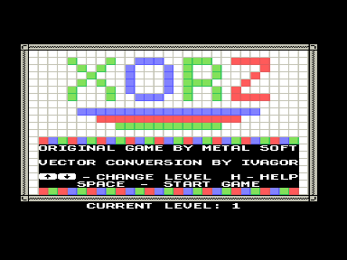
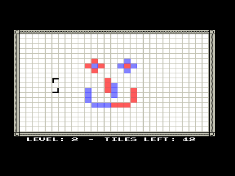

Оригинальная игра для MSX (на бейсике) - METAL SOFT (Vampier & Hydragon) (см. результаты MSXDEV09 - [http://msxdev.msxblue.com/status.htm](http://msxdev.msxblue.com/status.htm)).
Приведенный по предыдущей ссылке скриншот относится к предварительной версии, вот окончательный вариант - [http://msxdev.msxblue.com/msxdev09/roms/x0rz_final_package.zip](http://msxdev.msxblue.com/msxdev09/roms/x0rz_final_package.zip)

Версия для Вектора (на ассемблере) - Иван Городецкий (IvaGor, retrocom@yandex.ru, retrocomp.narod.ru).

Простая логическая игрушка.
Цель - «даунгрейдя» группы блоков игрового поля, превратить все его элементы в белые.
10 уровней.

## Управление в игре

- Движение курсора - соответствующие курсорные клавиши.
- Поворот курсора - `СС` (в b2m и Virtual Vector - левый Shift).
- «Даунгрейд» блоков, на которые указывает курсор - `УС` (в b2m и Virtual Vector - левый Ctrl).
- Выход в меню - `АР2` (в b2m - Esc; в Virtual Vector - PgDn).

Версия 1.0 - 27.01.2010
